# KaniKey — UX, keyboard and screens

> Design, 2026-10-25; device alignment 2026-11-19 (DOC-02); icon adoption
> 2026-11-20 (TNG-03). The images in `docs/screens` are **renders**, not
> device captures: `tools/mockups/render.py` draws the firmware's layouts with
> the M5GFX bitmap fonts (`Font0`/`Font1` 6×8, `Font2` 16 px, `Font4` 26 px),
> the 1bpp icons from `firmware/src/ui/Icons.h` and the RGB332 palette from
> `Theme.h`.
> Individual images are shown at 4× and the contact sheet at 2×; geometry and
> text sizes are the 1× ones, and the upscale is nearest-neighbour.
>
> Task IDs name the spec item that owns a behaviour. A **hardware pending**
> note means the behaviour is in the firmware but its check in
> [`docs/hardware.md`](hardware.md) has not been run.

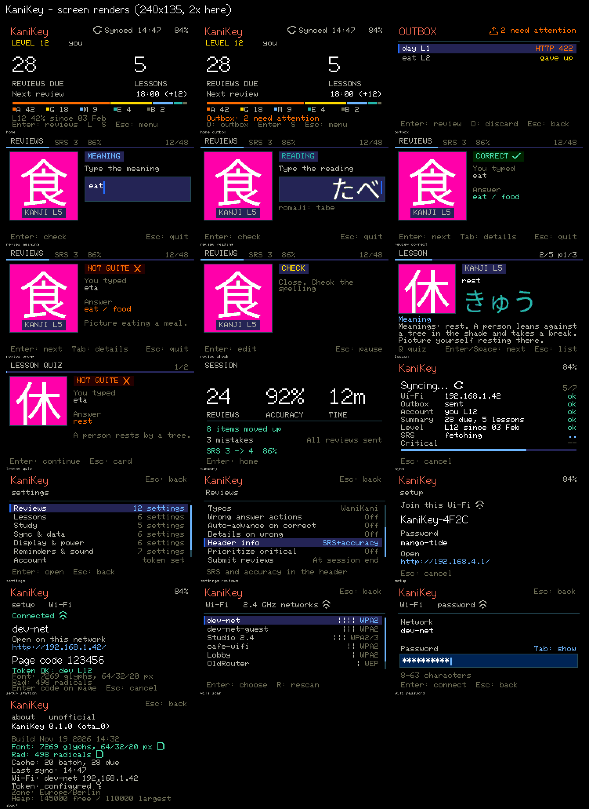

---

## 1. Principles

1. **The keyboard is the interface.** Typing an answer isn't an odd mode: it's
   the main action. The rest of the app is navigated with arrows and Enter.
2. **One focus per screen.** In the review, the item and the answer. On home,
   the reviews. In the lesson, the mnemonic. Nothing competes.
3. **The bottom bar says what the main keys do.** A shortcut that does not fit
   is listed in the `?` key help, not left invisible. If a key changes
   meaning, the bar changes.
4. **Color + shape + word.** Correct isn't just green; it has the `CORRECT`
   pill and word. Incorrect isn't just red; it has the `NOT QUITE` pill and
   word. The check/cross icons are supplementary: they follow the label, and
   the label alone still says what happened.
5. **Offline is stated.** One status line carries the most urgent state, such
   as `Offline - 2h old` or `Outbox: 4 pending`; outbox pending/attention
   replaces the offline/stale/vacation/level line. A level-up notice is shown
   after sync/outbox/offline and before vacation and level details. Never a
   generic error.
6. **Short texts.** The screen is 240×135; long sentences wrap onto several
   lines or move to a detail screen.

---

## 2. Visual language

### 2.1 Palette

| Token | Hex | Use |
|---|---|---|
| `bg` | `#0B0D10` | Background |
| `surface` | `#151A22` | Panels, rows, cards |
| `surface-hi` | `#202733` | Answer field, pills, hints |
| `line` | `#33404F` | 1 px borders, separators |
| `text` | `#F4F7FB` | Main text, kanji |
| `text-dim` | `#9BA8BA` | Secondary text, labels |
| `text-faint` | `#647184` | Metadata, help |
| `accent` | `#6C8CFF` | Focus, progress, `MEANING` |
| `accent-hi` | `#9DB2FF` | Accent on black |
| `brand` | `#FF7A59` | Brand, logo, details |
| `reading` | `#5EEAD4` | Readings, `READING` mode |
| `ok` | `#6EE7A8` | Correct |
| `ok-bg` | `#123326` | Correct background |
| `err` | `#FF6B6B` | Wrong |
| `err-bg` | `#351A1C` | Wrong background |
| `warn` | `#FBBF24` | Warnings, offline, low battery |
| `gold` | `#F5C451` | Level |

The hex column is the design value. The firmware stores each token as an
RGB565 constant in `firmware/src/ui/Theme.h` (for example `kSurface` `0x0108`);
the 8-bit canvas converts it to RGB332 and the panel expands that back. The
panel therefore shows `surface` as `#002455` and `surface-hi` as `#242455`, not
as the design hex. Do not add a colour outside `Theme.h` without changing the
header too. (The Home/Stats level label uses M5GFX's `TFT_GOLD`, which
quantizes to the same `#FFDB00` as `warn`.) The full quantized table and the
UI-08 contrast audit are in [design.md §8.1](design.md#81-palette-and-contrast-ui-08).

The palette is its own: warm black, indigo and coral. WaniKani's colors,
illustrations and components are not copied.

### 2.2 Typography

| Role | Font | Size | Use |
|---|---|---|---|
| Body, labels, hints | M5GFX `Font0` / `Font1` (GLCD) | 6×8 | Labels, hints, body text, rows, meters |
| Brand, titles | M5GFX `Font2` | 16 px | `KaniKey`, `Syncing...`, section titles |
| Big value | M5GFX `Font2` at size 2 | 32 px | Home counters, summary values |
| Large title | M5GFX `Font4` | 26 px | Boot, error and empty-state titles |
| Japanese prompt | Pack glyphs | 64 / 32 / 20 px | Kanji, radicals, vocabulary |
| Japanese reading | Pack glyphs | 32 / 20 px | Kana readings |

`Font0` and `Font1` are the same 6×8 GLCD font; M5GFX maps `setTextFont(1)` to
`Font0` (`HomeScreen.cpp:14,21,44,54,60`; `Widgets.cpp:12`). Body text and every
label and hint use it, including the pills (`Widgets.cpp:12`). `Font2` is
16 px and draws the brand and titles (`HomeScreen.cpp:14`); Home's counters
use it at size 2, which is 32 px (`HomeScreen.cpp:44`). `Font4` is 26 px and
draws boot/error titles (`BootScreen.cpp:45`, `LessonScreens.cpp:127`).
Japanese prompts and readings are never drawn with a UI font: the visual pack
supplies 64/32/20 px glyphs (`Widgets.cpp:47`, `platform/GlyphPack.cpp`), and a
missing glyph shows the explicit `no glyph` state. There is no separate UI
font file; Latin text is not rasterized on the device.

### 2.3 Grid

- Base unit: 4 px.
- Margins: 4 px.
- Header: 16 px (title + 2 px progress or a 1 px line).
- Hint bar: 12 px.
- Pills: 13 px high.
- Answer field: 32 px high.
- List rows: 11 px in menu-style lists (Settings, Wi-Fi, Outbox, the Study
  menu) and 20 px in content lists (lesson picker, critical/study rows);
  summary mistake rows are 26 px.
- Icons: 11×11, drawn after a label with a 4–6 px gap; they never replace text
  or set a row height.
- Square corners; no shadows; 1 px borders.

### 2.4 Components

- **Header:** title or brand on the left; Home adds the sync icon and sync
  text plus the battery value on the right; the review has a 2 px progress bar
  at the bottom. There are no Wi-Fi or battery icons.
- **Pill:** short uppercase label (`MEANING`, `READING`, `CORRECT`,
  `KANJI L5`) with a `surface-hi` background and semantic color. A feedback
  pill may add a check/cross icon after the label; the label stays in place and
  the pill grows to the right. Other pills have no icon.
- **Input:** `surface-hi` rectangle with a `line` border; meaning answers use
  the 6×8 font, kana readings the pack at 32 px with a 20 px fallback; 2 px
  caret in `accent`. The active answer field is the text-mode cue; there is no
  separate accent border.
- **Key hint:** 6×8 text in `text-faint`; the key and action share the one-line
  hint bar rather than a drawn keycap.
- **Progress:** 2–3 px bar; `surface-hi` track, `accent` fill.
- **Feedback:** pill + word + a supplementary check/cross icon after the
  label; never color alone. A warning (`CHECK`) has no icon because it must not
  imply a result.
- **List row:** `surface` background, `accent` focus, label left and value
  right; the lesson picker adds a `>`/`*` selection mark and a scroll thumb
  when the list overflows. Settings, Wi-Fi, Outbox, the lesson picker and the
  Study/critical lists share one window primitive; the hint bar is shared
  (TNG-03) and Home picks a shorter known variant when the full hint is too
  wide. The Outbox header carries the outbox icon; its rows do not.

### 2.5 Icons

TNG-03 adds seven 11×11 1bpp icons: `check`, `cross`, Wi-Fi, `sync`, SD,
`key` and `outbox` (`firmware/src/ui/Icons.h`). They are supplementary: a
label, word or colour always carries the meaning on its own, and no icon
replaces text.

Adopted slots:

- Review and lesson-quiz feedback: check after `CORRECT`, cross after
  `NOT QUITE`; `CHECK` keeps no icon.
- Home header: sync icon before `Synced HH:MM` / `sync n/m`, in the same
  colour as the text. The Sync screen title carries sync, check or cross after
  `Syncing...`, `Synced` or `Sync failed`.
- Outbox header: outbox icon before `N need attention`.
- Setup and on-device Wi-Fi: Wi-Fi icon after `Join this Wi-Fi`, `Connected`
  and the Wi-Fi scan/password subtitle.
- About: SD icon after the `Font:` and `Rad:` lines, key after `Token:`.

Intentionally skipped: the 10 px Sync rows, the 8 px Home status/outbox line
and other 8 px metadata, the 11 px Wi-Fi scan and Outbox/Settings list rows,
the review question/detail/summary/Stats screens, and warnings. The icon would
exceed the row height or compete with the value on the right; those slots stay
text-only. The battery, clock and security labels also keep words (`84%`,
`WPA2`) instead of an icon.

---

## 3. Keyboard

### 3.1 Physical map

The Cardputer ADV has 4 rows × 14 keys. The main layer is US; Shift gives
uppercase and symbols; Fn gives function.

```
  `  1  2  3  4  5  6  7  8  9  0  -  =  del
 tab q  w  e  r  t  y  u  i  o  p  [  ]  \
 fn  sh a  s  d  f  g  h  j  k  l  ;  '  enter
 ctrl opt alt z  x  c  v  b  n  m  ,  .  /  space
```

| Key | Normal layer | Shift | Fn |
|---|---|---|---|
| `` ` `` | `` ` `` | `~` | `Esc` |
| `1`–`0` | digits | `!@#$%^&*()` | `F1`–`F10` |
| `-` / `=` | `-` / `=` | `_` / `+` | `F11` / `F12` |
| `del` | Backspace | Backspace | Delete |
| `;` | `;` | `:` | `↑` |
| `,` | `,` | `<` | `←` |
| `.` | `.` | `>` | `↓` |
| `/` | `/` | `?` | `→` |
| `'` | `'` | `"` | — |
| `[` `]` `\` | literals | `{ } \|` | — |

### 3.2 Two modes

| Mode | When | What `; , . /` do | What the letters do |
|---|---|---|---|
| **Navigation** | Menus, home, feedback, lessons | Arrows (without Fn) | Context shortcuts (`L`, `O`, `S` on Home; `Q` on a lesson; `D` in Outbox) |
| **Text** | Answer field active | Characters `; , . /` | They type |

In text mode, the arrows are still available with `Fn + ; , . /`. The field is
marked with an `accent` border and caret; the bottom bar reads
`Enter: check` / `Esc: quit`.

When an answer ends (Enter) or is cancelled (Esc), it returns to navigation.
There's no need to press a button to “enter” the field: when a question opens,
the field is active.

### 3.3 Global shortcuts

| Key | Action |
|---|---|
| `Enter` | Check answer / continue / open / advance a lesson card / confirm the batch start / discard in Outbox |
| `Esc` | Back / cancel / pause session |
| `Tab` | Item detail on review feedback |
| `↑` `↓` | Move focus; in text, `Fn` + arrows |
| `←` `→` | Previous/next page in lessons, item detail and Stats |
| `Space` | Select a lesson row; next page in lessons and item detail; space in text |
| `?` (`Shift`+`/`) | Key help for Home, Settings, reviews, lessons, Outbox or Firmware; `Esc` closes it |
| `L` | Lessons (home) |
| `O` | Outbox of rejected/stuck reviews (home; ignored when none need attention) |
| `T` | Stats (home) |
| `P` | Extra study (home) |
| `S` | Sync (home) |
| `Q` | Optional single-item local quiz on a lesson card; the batch quiz runs after the last card |
| `D` | Discard the selected rejected/stuck review (Outbox) |
| `G0` | Short press wakes; long press is the future power action (not the pause menu) |

`Esc` from Home opens Settings; in a review it opens Pause → Settings. `Tab` on
review feedback opens the item card; `Tab` is the dev-build debug shortcut only
on Home. `?` opens the key-help overlay listed in §5.12; it swallows every
other key until `Esc` closes it, and plain `/` remains Right.

### 3.4 Repeat and modifiers

- The arrows and Backspace repeat (`keyRepeats()`): 400 ms delay, then 120 ms
  per step. Backspace repeats only while an answer field is active; feedback,
  the detail card, Pause, Settings and help never consume it. Enter and Esc
  never repeat.
- `Fn`+Backspace or `Ctrl`+Backspace clears the active answer field, including
  the dim romaji line. Reading Backspace removes one kana unit (`たべ`→`た`,
  `かん`→`か`, `んや`→`ん`), and an answer is capped at 64 bytes.
- Letters don't repeat: this avoids accidental answers from holding a key down.
- Shift, Ctrl, Opt and Alt are tracked as state; on their own they don't
  produce a character (Shift changes the layer of the next one).
- If the TCA8418 loses events (overflow), everything is released and a discreet
  notice is shown; a key never gets “stuck”.

---

### 3.5 Two buttons (PaperDIY)

The PaperDIY has no keyboard: two buttons, A and B, and no touch. The same
screens run with a button map (`docs/spec/10-bluetooth-paperdiy.md` §2.4):

| Button | Short tap | Hold (600 ms) |
|---|---|---|
| A | next (row, option, page) | open / confirm (Enter) |
| B | back (up, close, cancel) | previous (row, option, page) |

- Hints name the buttons: `A: next  hold A: open  B: settings` on Home,
  `hold A: retry  B: home` on a notice. Keys are never named on that board.
- Home is a focus ring over Lessons, Stats, Sync and Settings; reviews are not
  a destination there.
- Reviews, quizzes, lesson start and text entry are not offered. A try shows
  `Needs a keyboard` and a button closes it. Read-only browsing (Home, lesson
  list and card, item detail, Stats, Sync, Outbox and most of Settings) works.
  Wi-Fi entry is on the Setup portal instead.
- The keyboard hints and keys are unchanged on the Cardputer.

## 4. Flows

### 4.1 First setup

```
Boot
 └─ Wi-Fi saved? ──no──► Setup
                          ├─ 1. WPA2 AP KaniKey-XXXX; key and URL on screen
                          ├─ 2. Portal: save the home Wi-Fi
                          ├─ 3. Device joins; station page with page code
                          ├─ 4. Token: GET /user, then time from the browser
                          ├─ 5. Visual pack? ──no──► Download pack on the page
                          └─ 6. First sync (user/summary/level/SRS counts)
```

- The portal opens for first setup and can be reopened from Settings; it closes
  when setup finishes. After 15 minutes without a request it closes itself and
  the device returns to boot with `Setup timed out`.
- The temporary network uses WPA2 with a new random 10-character key visible on
  screen for each portal start (no `0/O/1/I/l`, so it is easy to read and type).
  It's not an open network.
- The station page is reachable from the whole home network, so it stays locked
  until the 6-digit code shown on the device screen is typed into its unlock
  field. That browser then keeps an HttpOnly, `SameSite=Strict` session cookie;
  after five wrong codes the device shows a new code. The code itself is never
  part of the served page or the URL.
- The token is pasted in the portal; it's validated with `GET /user` before
  saving.
- A missing font pack does not need a computer: the station page offers
  `Download pack` and the device checks size and SHA-256 before using it. The
  radical pack is optional and arrives through the upload form or not at all.
- If the user cancels, the device returns to boot with `Setup cancelled` and
  doesn't sync.

### 4.2 Daily review

```
Home ──Enter──► Review (cached batch; fetch if absent)
                                   ├─ Meaning: type, Enter
                                   ├─ Reading: romaji→kana, Enter
                                   ├─ correct: brief feedback, Enter
                                   ├─ wrong: feedback + requeue
                                   └─ completed: write to the local outbox
                                   ──► Summary: send per R12
                                         ├─ At session end (default)
                                         ├─ Every 5
                                         └─ Immediately (one POST per item)
```

- An automatic sync can run in the background at boot or wake (§5.11); `Enter`
  starts the cached batch as soon as it is available and does not wait for the
  sync. Without a cached batch it fetches one first.
- The session freezes when it starts: items added later don't appear until the
  next one.
- `Pause` keeps the session in memory. `End session` sends (or queues) what is
  completed, saves the outbox and returns Home; the unfinished queue is not
  persisted, so a reboot or power loss loses it. Completed reviews stay in the
  outbox.
- With the default R2 `Account preference` the order is stable-random per
  session, mixing types; R3 can group types. Items answered wrong come back
  3–5 positions later.
- A completed review enters the outbox before its feedback is drawn. R12
  chooses when the session's records are POSTed; `Esc` during the summary send
  loop leaves the rest Pending for the next sync.

### 4.3 Offline

```
Home (Offline) ──► Review with cache ──► completed to outbox
                                         │
                                    when network returns
                                         │
                                    Sync outbox (1 by 1)
```

- Home shows the cached state or the pending/attention outbox count in the
  single status line, whichever is more urgent (for example `Offline - 2h old`
  or `Outbox: 4 pending`).
- If an item has no cached subject, it isn't offered. If no reviewable item
  remains, the session does not start; there is no separate “needs a
  connection” line yet.
- When the network returns, the outbox is sent before the summary is
  refreshed.

### 4.4 Lessons

```
Home ──L──► Lessons list ──Space──► select up to N
                              └─ Enter ──► Cards
                                           ├─ Space / →: next page
                                           ├─ Enter: next page, next card on the last page
                                           ├─ ← / Backspace: previous page or card
                                           ├─ Q: optional single-item quiz
                                           └─ after the last card
                                                ├─ L3 Required (default): batch quiz
                                                └─ L3 Skip: straight to the confirmation
                                                     └─ Enter: start the whole batch
                                                          └─ PUT /assignments/{id}/start per item
```

- The list opens with the first N rows selected (LES-01; N = L1 `Batch size`,
  clamped to the account's `lessons_batch_size`). `Space` toggles a row and
  says `batch full` when N are selected; `Enter` studies the selection; `Esc`
  returns Home.
- The card pages by topic (LES-06): `Meaning`, `Reading` (skipped when the
  subject needs none), `Components and notes`, and `Context` when parts of
  speech or context sentences exist. A long topic continues on further pages
  with its title repeated; component meanings, hints and the user's notes are
  in `Components and notes`.
- Nothing is sent while browsing: paging, the batch quiz and `Q` never call
  `PUT /start`. After the last card the batch quiz runs unless L3 is `Skip`; it
  covers every selected item, meaning first and reading where the subject has
  one, and requeues a wrong part.
- The confirmation reads `Start N lessons? They join your reviews in about 4
  hours.` with `Enter: start  Esc: back`.
- `Enter` starts the items one at a time with `Starting 2/5`. 2xx and 422
  (already started) count as started; any other status stops the run, keeps the
  unstarted items and shows `Could not start` with `Enter: retry  Esc: back`.
  Started items leave the summary and Home's lesson count drops immediately,
  without a sync.
- Offline, browsing and the quiz still work; starting shows
  `Needs Wi-Fi - your batch stays here` and leaves the batch intact.
- **L2 order and L4–L6 guard (LES-04/05):** `WaniKani` (default),
  `Radicals>Kanji>Vocab` or `Interleave types`; the whole candidate pool is
  sorted before the batch limit. The L4/L5/L6 thresholds are checked locally
  before Wi-Fi or the low-battery prompt; `WORKLOAD CHECK` lists every exceeded
  reason and `Esc` returns Home without a fetch.
- **Hardware pending:** the full quiz with mistakes and no outbox growth, the
  offline start, 422, L3 `Skip`, the 60-candidate order, the multi-reason guard
  and L5/L6, and the visual checks. The list, first card, batch quiz and a real
  5-item start (all `PUT /start` returned 200 and Home dropped from 120 to 115
  lessons) are recorded in [`docs/hardware.md`](hardware.md), 2026-11-19.

### 4.5 Conflicts and errors

| Situation | What the user sees | What the app does |
|---|---|---|
| Invalid token (401) | `Auth: token rejected` on Home; `Token rejected` on Boot | Arms the shared auth gate; Boot/Sync Enter opens setup |
| No permission (403) | `Auth: missing permissions` / `Missing permissions` | Endpoint-specific; Boot/Sync Enter offers the token page |
| Rate limit (429) | `Rate limited; retry in 42s` | Shared gate waits for `RateLimit-Reset`; no immediate retry |
| No network | `Offline - 2h old` + cache | Continues with the cache |
| 422 on submit | `WaniKani rejected this review (HTTP 422)` in Outbox | Marks it rejected; keeps it for `O: outbox` |
| 409 on submit | `Conflict (409); it may have changed` | Marks it rejected; keeps it for `O: outbox` |
| 50 failed attempts | `Not sent after N attempts` | Marks it stuck; keeps it for `O: outbox` |
| SD removed | `No SD card` | Retry; a session cannot fetch subjects |
| Missing glyph | `no pack` + `check SD` (no font); `no glyph` + `no radicals` or `not in pack` | Draws the explicit state; does not fake a character |
| Unreliable clock | `Clock not set` | Requests sync; if not, `created_at` is omitted |

---

## 5. Screens

Each screen is a base screen. Pause, Settings, About, sign-out, the Outbox
discard confirmation, the low-battery prompt and the firmware-install
confirmation are modals on a four-deep stack (ARCH-04): drawing and keys go to the top
modal, and `Esc` pops exactly one level (Pause → Settings → About returns
About → Settings → Pause). Lesson start and the batch quiz are sub-states of
the lesson screen; Stats, Extra study, Critical items, on-device Wi-Fi and
notices are separate screens that also keep the device awake.

### 5.1 Boot

- Black background, `KaniKey` in coral, a 26 px `Font4` title and one or two
  6×8 lines; the current boot screen has no progress bar.
- The boot screen shows one state title (`No SD card`, `Pack missing`, `Token
  needed`, `Wi-Fi needed`, `Not synced`, `Syncing...`, `Token rejected`,
  `Missing permissions`, `Rate limited`, `WaniKani error`, `Sync failed` or
  `Ready`) and one or two 6×8 lines. Sync progress has its own screen (§5.11).
- If something critical fails, a single sentence and an action:
  - `No SD card` / `Insert a FAT32 card` / `Enter: retry`.
  - `Pack missing` / `Press Enter to download it` / `from the setup page` /
    `Enter: setup`. The station page offers `Download pack`; a missing radical
    pack does not block boot and only changes radical prompts to the explicit
    `no glyph` state (`no radicals` when that pack is absent).
- It doesn't show technical logs.

### 5.2 Setup

- Header `KaniKey` in coral, `setup` (or `setup · Wi-Fi` once connected) in
  the 6×8 font and the battery on the right. The screen has two states.
- `Join this Wi-Fi` (AP) and `Connected` (station) carry the Wi-Fi icon after
  the word. The on-device scan and password headers carry it after their
  `Wi-Fi · ...` subtitle.
- **Access-point state** (no saved Wi-Fi):
  - `Join this Wi-Fi`, the SSID `KaniKey-XXXX` in `Font2` (16 px).
  - `Password` and the random 10-character WPA2 key.
  - `Open` and `http://192.168.4.1/`. The page carries the Wi-Fi form.
  - `Esc: cancel` returns to boot with `Setup cancelled`.
- **Station state** (the device has joined the home network):
  - `Connected` and the SSID.
  - `Open on this network` and the station URL.
  - `Page code 123456` in `Font2`; the page asks for that code before it shows
    the token, pack, clock or Finish forms (and `Change Wi-Fi`). The code is
    never in the served page or the URL. Five wrong codes issue a new code.
  - Token status (`Token OK: you L12`, `Token stored: validate on the page` or
    `Token needed: enter it on the page`) and the pack status row
    (`Rad: 498 radicals`). The line above it is the latest portal message;
    with no message it shows `Font: 19683 glyphs, 64/32/20 px` (the public
    pack; a personal pack can differ).
  - `Enter code on page  Esc: cancel`.
- The portal is reachable from the whole home network and closes when setup
  finishes or after 15 minutes without a request. A locked station page shows
  the setup header, the notice and the unlock field only; the status, token
  and pack blocks stay hidden. **Hardware pending:** the 15-minute close
  (FIX-07) and the pack checks below (see [`docs/hardware.md`](hardware.md),
  2026-11-19).

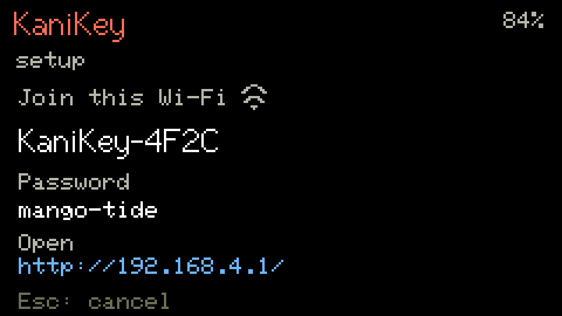
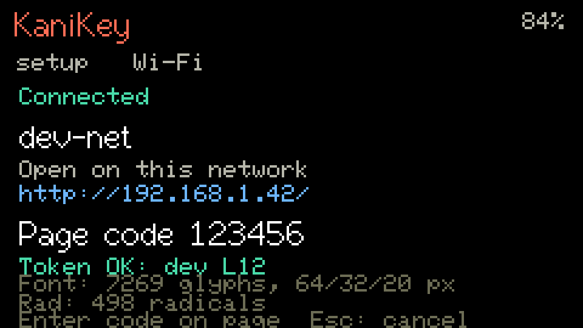
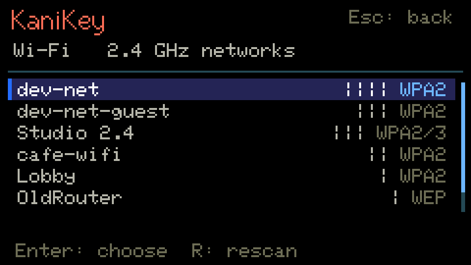
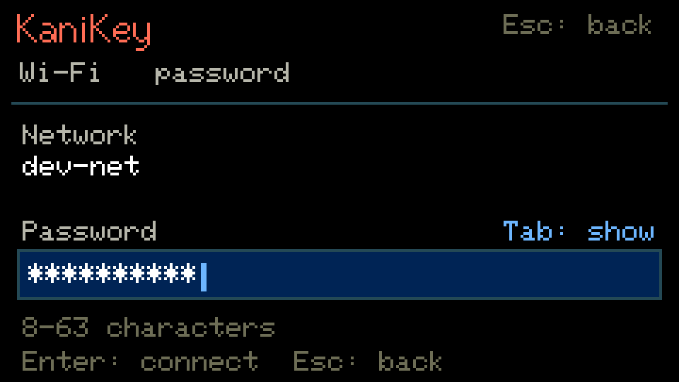

- **On-device Wi-Fi (SETUP-09, 2026-11-19).** Settings › Account › Wi-Fi opens
  a 2.4 GHz scan: SSID left, signal bars and `WPA2`/`WPA2/3` right, plus a
  `+ Enter network name` row for hidden networks. The header carries the
  Wi-Fi icon after the subtitle; the scan rows keep signal bars and security
  text only. `↑↓` moves, `Enter` chooses,
  `R` rescans and `Esc` returns to Account. The password screen shows the SSID,
  a masked field, `Tab: show` / `Tab: hide` and `8-63 characters; empty for
  open`; `Enter` joins, `Esc` goes back. A failed join keeps the password
  editable and shows `not found`, `wrong password`, `timeout`, `unsupported`
  or `save failed`; credentials are saved only after a successful join. The
  phone portal above remains the token/time/pack path and the boot fallback.
  **Hardware pending:** join/save/failure, hidden SSID, the boot flow, review
  lock and power guard (see [`docs/hardware.md`](hardware.md), 2026-11-19).
- **Pack from the station page (ONB-02, 2026-11-19).** The Visual pack block
  shows `Font:` and `Radicals:` statuses, `Check pack again`,
  `Upload radical pack` and the free card space; `Download pack` appears only
  on the station page while the font pack is missing. The download reads the
  release manifest over HTTPS, streams to `glyphs.kgp.tmp` with `Pack n%` and
  `Esc` cancel, checks exact size and SHA-256, proves the file opens as a font
  pack, then reopens it. A transport, size or SHA failure, or `Esc`, leaves the
  old file in place; a file that is not a font pack is rejected and removed.
  The upload sends a multipart `radicals.kgp` to `radicals.kgp.tmp`, is
  unlock-gated before the first byte, caps at 32 MB, checks free space and
  accepts only a v2 kind-2 pack; the CRC is not checked there. `Check pack
  again` always defers a full CRC re-open of both packs, even when both were
  already ready, and the next page load shows the new status.
  **Hardware pending:** the empty-card download, cut Wi-Fi, valid phone upload,
  truncated upload, `Esc` cancel and heap checks (see
  [`docs/hardware.md`](hardware.md), 2026-11-19).

### 5.3 Home

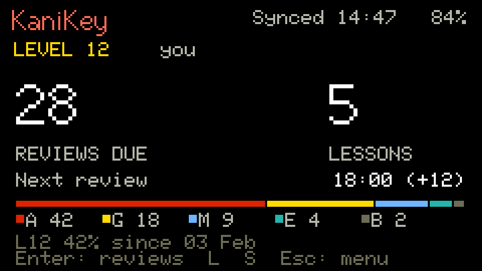
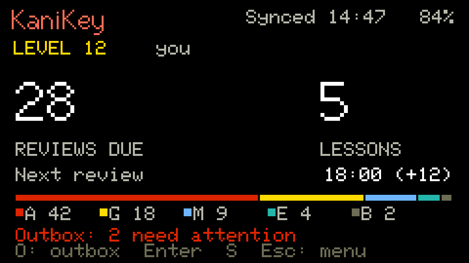

- Header: `KaniKey` in `Font2` (16 px, coral), `Synced 14:47` in
  `Font1` (6×8, dim) and the battery as `84%` (or `USB`) in `Font1`, both
  right-aligned. A sync icon sits before the sync text in the same colour.
  While an automatic sync runs, the right text is `sync n/m` instead of
  `Synced HH:MM` and returns to the clock when the job finishes (SPEED-03).
  There are no Wi-Fi or battery icons on the device.
- `LEVEL 12` in gold and the username next to it in the 6×8 font.
- Due reviews (`28`) at 32 px and the `REVIEWS DUE` label at 8 px.
- Lessons (`5`) at 32 px and `LESSONS` at 8 px.
- `Next review` at 8 px, with a right-aligned value. With reviews due and a
  later bucket it reads `+12 at 18:00`; with nothing due, `18:00 (+12)`; with
  due items and no later bucket, `now`; with nothing scheduled, `all clear`.
- SRS distribution: five segments at y=100 (3 px high, 224 px wide) in
  apprentice/guru/master/enlightened/burned colors, with `A 42`, `G 18`,
  `M 9`, `E 4`, `B 2` and 4 px swatches below. The counts come from the last
  sync and are cached; if they are missing, the line reads
  `SRS: sync for counts`.
- The due count and `Next review` are recomputed from the cached hourly buckets
  once a minute while Home owns the screen, and the redraw also refreshes the
  battery (SPEED-07). No request is made. With an untrusted clock, the
  effective time advances with uptime from the last cache save and re-anchors
  on the next sync. **Hardware pending:** the 60 s tick and the offline-clock
  line (see [`docs/hardware.md`](hardware.md), 2026-11-19).
- The single status line at y=117 shows the most urgent state after the
  auth/rate/server errors above. If the outbox is not empty it shows
  `Outbox: N pending` in amber or `Outbox: N need attention` in red at 8 px,
  replacing the offline/stale/vacation/level line. The attention
  count is rejected + stuck; pending does not include either. When items need
  attention, the hint becomes the `O: outbox` variant below (§5.13). Above 75%
  (96 of 128 slots, every state counted) the line appends `(nearly full)`.
  The 8 px line stays text-only; the outbox icon is on the Outbox header, not
  here. The minute tick above also refreshes the battery, so charging shows
  without a keypress.
- Priority of the status line: auth/rate/server error, outbox, offline/stale,
  level-up notice, vacation, level line. A level-up notice keeps priority over
  vacation and level until sign-out.
- Level line: `L8 42% since 03 Feb`, or `L8 42%` when the date is unavailable.
  The percentage is the rounded `passed kanji * 100 / total kanji` for the
  level (0 when the total is unknown); passed means Guru or later (SRS stages
  5-9). When the counts could not be fetched, the existing `L8 since 03 Feb`
  line is kept.
- Hint: `Enter: reviews  L  S  Esc: menu`. With rejected or stuck items it
  becomes `O: outbox  Enter  S  Esc: menu`; `O: outbox` stays first. The
  shared hint bar falls back to shorter variants when the text is too wide;
  `T` and `P` are listed in the `home` help table instead of the bar, and `?`
  opens that table. `Esc` still opens Settings. The M0 debug screen and the `Tab: debug` shortcut only
  exist in the `cardputer-adv-dev` build; the shortcut is no longer advertised
  on Home.
- States:
  - **Sync:** `S` starts the same manual full sync as Settings › `Sync now`;
    the Sync screen (§5.11) replaces Home while that manual sync runs. The
    automatic boot/wake sync leaves Home up and shows `sync n/m` in the header;
    `Enter` starts a cached review at the next step boundary and `Esc` opens
    Settings.
  - **Offline:** when no outbox item is pending or needs attention, the status
    line in `warn` reads `Offline - 2h old`; after 24 h, `Stale cache - 2d old`.
  - **Empty:** the counters show `0` and `Next review` shows the next time (or
    `all clear`); `Enter` with nothing due opens `No reviews now` with
    `Next review HH:MM` and `Enter: sync  Esc: home`, without a network call.
  - **Fetch errors:** a failed review fetch shows `Could not load reviews` with
    the error line and `Enter: retry  Esc: home`; a failed lesson fetch shows
    `No lessons available` with the same keys (§5.16).
  - **Vacation:** `Vacation mode` in amber in the status line when no more
    urgent sync/outbox/offline/level-up message is shown.
  - **Level:** `L8 42% since 03 Feb` (or `L8 42%`) in faint text in the status
    line when nothing more urgent is shown. The counts are cached with the
    level timestamps; without counts it falls back to `L8 since 03 Feb`.
  - **Level up:** after a sync raises the account level, the status line shows
    `Level up! L8 -> L9` in green instead of the level line. It is not shown on
    the first sync without a known previous level, stays for the session and is
    cleared on sign-out, a new token or a level decrease.
  - **Error:** Home shows `Auth: token rejected`, `Auth: missing permissions`,
  `Rate limited; retry later` or `WaniKani error; retry`. Boot shows distinct
  `Token rejected` / `Missing permissions` / `Rate limited` / `WaniKani error`
  screens; `Enter` retries or opens setup. `Esc` → Settings → `Sync now` retries.
- **Low battery:** below 20% on battery, starting reviews or lessons asks for
  confirmation; USB power skips the prompt.
- **Reminder banner (REM-02, 2026-11-20; hardware pending).** A reminder
  timer wake (set by M1 or M3, §5.12) starts with no Wi-Fi. If the cached
  summary has at least M1 reviews due (1 when M1 is off and M3 is set) and the
  moment is outside quiet hours, Home opens with the next-review row replaced
  by the accent banner `25 reviews ready` (`1 review ready` for one) and the
  hint `any key: continue`. The banner stays for 30 s. Any key in that window
  ends it and the normal boot goes on (the usual quick sync, the header shows
  `sync n/m`). Otherwise the panel stays dark, the next wake is armed and the
  chip sleeps again. Without a cached summary there is no banner.
  **Hardware pending:** the banner text width at 240×135, the 30 s expiry and
  the re-sleep with Wi-Fi off (see [`docs/hardware.md`](hardware.md)).
- No side menus or cards covering the numbers are shown.

### 5.4 Review

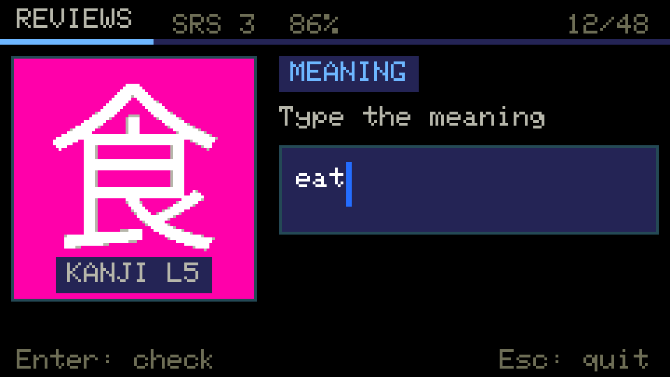
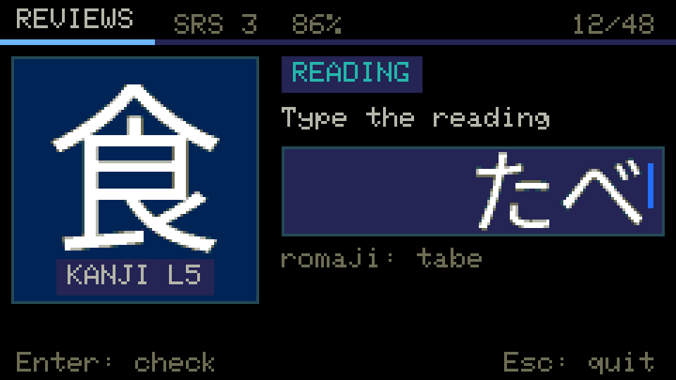

- **REV-08 orders (2026-11-19).** R2 `Order` chooses `Account preference`
  (default), `Random`, `Lowest level first`, `Current level first`, `SRS
  ascending`, `SRS descending` or `Oldest available first`; R3 `Type order`
  groups radicals then kanji then vocabulary inside that order. Account keeps
  today's shuffle/lower-levels path and adds no request; other orders fetch the
  summary's due assignment metadata in 60-id pages, select the batch, then
  re-apply the comparator. A failed fetch falls back to Account with a log;
  cached/offline sessions use the same order. A real review starts at `1/20`
  after the fetch; no answer is sent while browsing. **Hardware pending:** the
  visible order, type grouping, fallback and cached cases (see
  [`docs/hardware.md`](hardware.md), 2026-11-19).
- Header `REVIEWS` (6×8 font), `SRS 3 86%`, `12/48`; 2 px progress bar.
  There is no Wi-Fi or battery icon on this screen. With R10 `Header info` set
  to `Minimal`, only the `SRS 3 86%` block is hidden; the title, counter and
  progress bar stay. **Hardware pending:** the minimal header (see
  [`docs/hardware.md`](hardware.md), 2026-11-19).
- R5 `Back-to-back` is On by default: after one part, the other part of the
  same item is asked immediately. Off interleaves items so parts of different
  items alternate, but a single-item queue still asks the other part so it
  cannot stall. These options are hardware pending (see
  [`docs/hardware.md`](hardware.md), 2026-11-19).
- With R11 `Prioritize critical` on, due critical subjects are moved ahead of
  the rest; the chosen R2 order is preserved inside both groups and the batch
  limit is applied after the partition.
- Left panel 88×88:
  - 64 px kanji/radical, centered.
  - Pill `KANJI L5` or `RADICAL L3` below.
  - Vocabulary: the word scales to 64/32/20 px to fit the 78×80 panel; if none
    fits, the prompt shows the missing-glyph state.
  - Radical without Unicode: bitmap from the visual pack.
- Right panel:
  - Pill `MEANING` (indigo) or `READING` (teal).
  - Instruction: `Type the meaning` / `Type the reading`.
  - 32 px field with the answer; caret. A meaning answer is 6×8 text; reading
    kana uses the pack at 32 px with a 20 px fallback.
  - In reading, below: `romaji: tabe` in gray; the field shows `たべ`.
  - Romaji follows WanaKana: `n` before a vowel or `y` is a syllable
    (`konya` → こにゃ). Type `n'` for ん (`kon'ya` → こんや); `konya` shows
    `Use n' before a vowel or y` and can be retried without a mistake.
  - `Tab: details` is shown on feedback; the question bar only has check/pause.
- Bar: `Enter: check`, `Esc: quit` (which opens Pause).
- The field is active as soon as the question appears. Nothing needs to be
  pressed.
- If the answer is long, the text scrolls horizontally; the caret stays
  visible. It doesn't wrap to two lines so as not to change the height.
- `Esc` in a review opens `Pause` (Continue / Wrap up / End session /
  Settings). `Wrap up` keeps the current item plus queued items with one part
  already done, drops untouched items, and shows `WRAP UP N` with the pruned
  counter/bar; choosing it again is harmless and the summary opens after the
  last kept item. `Esc` closes Pause and continues. **Hardware pending:** the
  multi-item prune, repeated Wrap up and the summary handoff (see
  [`docs/hardware.md`](hardware.md), 2026-11-19). Holding G0 remains the future
  power action.
- Idle: with the default P2–P4 timers, the panel dims at 30 s, blanks at 60 s
  and the device deep-sleeps at 2 min when no review is active and it is on
  battery. On a blank panel the first key only wakes it. SPEED-06 light sleep
  is not part of the current build.

**Implementation note (M5).** The live build draws the 64 px prompt, 32 px
reading and 20 px feedback from the SD visual pack. Vocabulary words composed
of several characters are laid out from individual glyphs. Radicals use their
bitmap from the visual pack when the subject has no Unicode character; a
missing glyph shows an explicit `no glyph` state. The bottom bar says
`Enter: check` / `Esc: quit`; `Esc` opens the Pause menu (Continue / Wrap up /
End session / Settings), so quitting is deliberate. `Tab` on feedback opens the detail card
(§5.6). The screen is driven by the same review queue and answer checker as the
final design. With R2 `Account preference` (the default), the session order
follows the account's `reviews_presentation_order`: shuffled, or lower levels
first with the shuffle kept inside each level.

### 5.5 Feedback

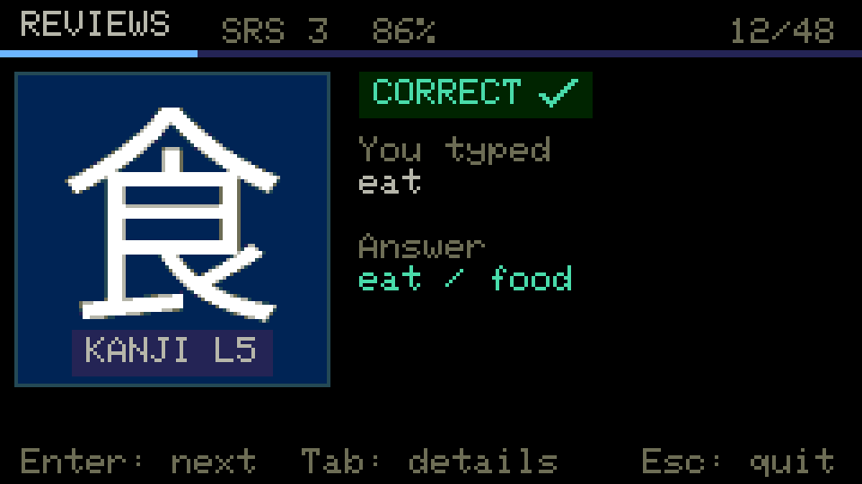
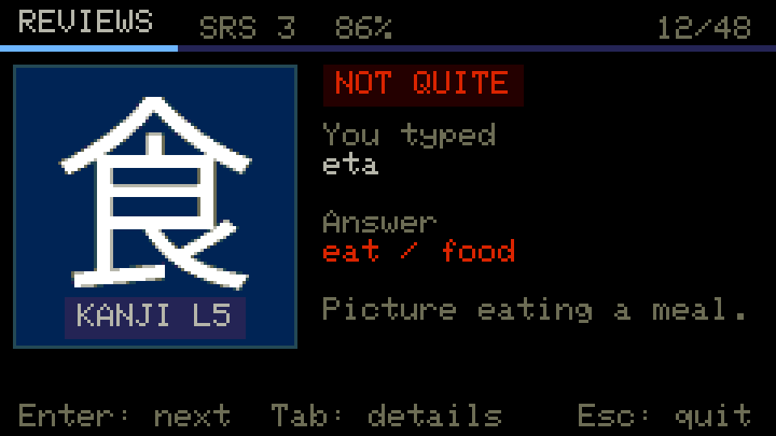
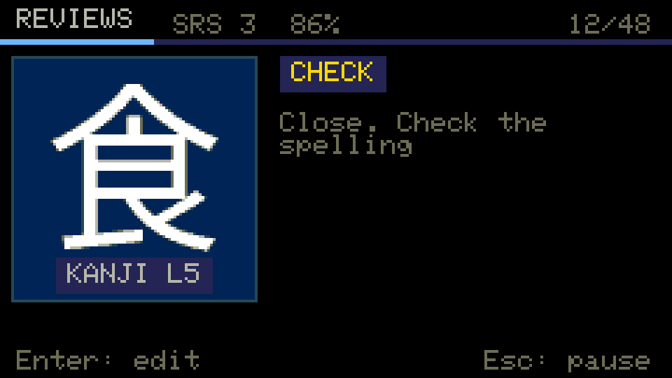

- The left panel doesn't change; the right one turns into feedback.
- Correct:
  - `CORRECT` pill in green with a check icon after the word.
  - `You typed` and the answer in gray.
  - `Answer` lists every accepted meaning or reading joined by ` / `; kanji
    readings are grouped on'yomi first and kunyomi second, and user synonyms
    follow in faint after `+`. Nothing is cut: the list is part of the scrolling
    body below.
  - `Enter: next`, `Tab: details`.
- Wrong:
  - `NOT QUITE` pill in red with a cross icon after the word.
  - `You typed` and the user's answer.
  - `Answer` with the accepted list, same layout as Correct.
  - The first sentence of the part's hint, else the user's note, shown in full
    (wrapped, scrollable); never the generic `Incorrect meaning` /
    `Incorrect reading` line.
- **REV-02 typo policy (2026-11-19).** With R6 `Typos = WaniKani` (default), a
  close meaning of at least four characters is **Correct**, with
  `Close: <answer>` on the note line and no mistake; the part completes and R8
  can auto-advance. With `Strict` the same answer is a CHECK that retries the
  same part and keeps the answer hidden. Readings are unchanged and lessons
  use the same policy. **Hardware pending:** the Strict path and the lesson
  quiz (see [`docs/hardware.md`](hardware.md), 2026-11-19).
- **R7 wrong-answer actions (2026-11-19).** With R7 `Wrong answer actions` On,
  Incorrect feedback adds `C ok` (undo the counted mistake, accept the part
  and advance) and `A later` (undo it, ask the part again later); the compact
  bar reads `C ok  A later  Tab info`. Both use the normal completion path, so
  the due count, cache, outbox and practice journal match a normal answer; the
  local journal records the override and the POST carries the adjusted counts
  as usual. C/A do nothing on Warning and with R7 Off; with R7 Off the help
  omits their rows. **Hardware pending:** C/A, the warning case, the bar/help
  and practice (see [`docs/hardware.md`](hardware.md), 2026-11-19).
- Warning (`CHECK` pill in amber, no icon):
  - Only the pill and the message are shown; no typed row and no answer row, so
    the expected answer cannot leak.
  - `Tab` does nothing. The hint bar reads `Enter: edit  Esc: pause`.
  - `Enter` returns to the same question with the typed text intact (meaning
    string and IME raw buffer), ready to be corrected and resubmitted. A strict
    typo warning says `Close. Check the spelling` without naming the answer.
- Feedback doesn't last a fixed time by default: it waits for `Enter`. With R8
  `Auto-advance on correct` set to 0.5 s, 1 s or 2 s, a CORRECT answer advances
  after that delay. Typing a printable key during CORRECT feedback advances
  immediately and feeds the key into the next field (`;` and `.` are the
  scroll keys and do not advance; `,` and `/` still do); wrong and warning
  feedback, the detail card, pause, Settings and the blank screen never
  advance. R8 is Off by default, so the current Enter-only behaviour stays.
  **Hardware pending** (see [`docs/hardware.md`](hardware.md), 2026-11-19).
- `Tab` opens the full card: meanings, readings, mnemonic and components.
- With R9 `Details on wrong` On, a wrong answer opens the card once, directly
  at page 2 for a failed meaning or page 3 for a failed reading; `Esc`/`Tab`
  returns to the same NOT QUITE feedback and a later `Tab` starts at page 1.
  Correct and warning feedback never open it, and R9 is Off by default.
- **Implementation note (2026-10-28).** After a correct answer, the free lines
  under the answer show the user's meaning or reading note when one exists.
  Wrong answers show the hint sentence described above. `Tab` opens the full
  detail card described in §5.6.
- **Implementation (2026-11-19, REV-01/03).** The accepted-answer layout and
  the hint fallback are live; the lesson quiz uses the same layout.
  **Hardware pending:** multiple meanings, grouped kanji readings, the hint
  fallback and the lesson-quiz layout (see [`docs/hardware.md`](hardware.md),
  2026-11-19).
- **Feedback body (REV-01/03, 2026-11-20; hardware pending).** The typed text,
  the answers, the synonyms and the note lines form one body under the pill:
  x 100 to 236 (x 86 to 236 in the lesson quiz), y 36 to 118, above the hint
  bar. The left prompt panel and the header do not change.
  - Layout: each section starts a new row (`You typed`, the typed text,
    `Answer`; for a reading `Y` and `A`), then the answers, then the notes. No
    line is cut and no `...` is added.
  - Latin wraps between words; a word wider than the box splits by character.
    Japanese (readings and kana answers, at 20 px) wraps between characters.
    A row never mixes Latin and Japanese.
  - Answers keep their ` / ` separators; the on'yomi and kun'yomi groups of a
    kanji are four spaces apart; synonyms follow `+`. A Japanese piece the pack
    cannot draw shows `no glyph`.
  - Up/Down (`;` up, `.` down) scroll one 8 px line per press, clamped to the
    content. The scroll starts at the top for each new answer and survives a
    trip to the detail card.
  - A 2 px track at x 238 (the list style) shows only when the body overflows.
  - Hint bar: `;/. scroll` is added only when the body overflows, with the
    answer keys kept first: `Enter: next  ;/. scroll`,
    `C ok  A later  ;/. scroll` (R7 On), `Enter: edit  ;/. scroll` (CHECK), and
    in the lesson quiz `Enter: continue  ;/. scroll  Esc: card`. When the card's
    longer form does not fit, the short form shows.
  - Auto-advance (REV-06): an Up or Down on CORRECT feedback cancels the timer
    for that frame, as any other non-printable key does, so the answer waits for
    `Enter`. Scroll keys never advance. C/A, R, Tab, Enter and Esc are unchanged.
  - The layout is `wk/FeedbackLayout` (pure, native-tested with Latin, Japanese
    and mixed text at fixed widths); the drawing is `ui::drawFeedbackBody`.
- **Sound (REM-03, 2026-11-20; hardware pending).** With M4 `Sounds` On (default
  Off), a correct answer plays two short rising tones and a wrong answer one low
  tone, in reviews and in both lesson quizzes. A Warning (CHECK) plays nothing.
  Each tone is at most 120 ms, starts with the answer and never holds a key. M5
  `Volume` sets the level (§5.12). Nothing sounds during a sync or in the setup
  portal.

### 5.6 Item detail

- Header `ITEM DETAIL` with the page counter; type and level sit in the pill.
- Character/radical on the left; meanings and readings on the right.
- Pages with `←` `→` or `Space`:
  1. Meanings, readings and synonyms.
  2. Meaning mnemonic + hint.
  3. Reading mnemonic + hint.
  4. Meaning/reading notes.
  5. Components (radicals/kanji) with their meanings.
  6. Vocabulary: parts of speech + context sentences (when present).
  7. Related subjects: similar/amalgamation counts and cached meanings (when
     present).
- If the mnemonic isn't cached: `No mnemonic cached.`
- `Esc` or `Tab` returns to the review without losing the written answer.

**Implementation note (2026-10-28).** `Tab` on feedback opens the live card.
The page count depends on the subject: five base pages, plus vocabulary and
related pages when they apply. `Space`/`←`/`→` page and `Tab`/`Esc` returns to
feedback.

**Implementation (2026-11-19, REV-07).** R9 `Details on wrong` is live: an
Incorrect answer opens the card at page 2 (meaning mnemonic) or page 3 (reading
mnemonic), matching the failed part, and keeps the feedback state underneath.
Returning does not reopen it; `Tab` from feedback still starts at page 1. A
missing mnemonic shows `No mnemonic cached.` Correct and warning feedback are
unchanged. **Hardware pending:** wrong meaning/reading page, return, Correct/
Warning and the empty-mnemonic state (see [`docs/hardware.md`](hardware.md)).

### 5.7 Session summary

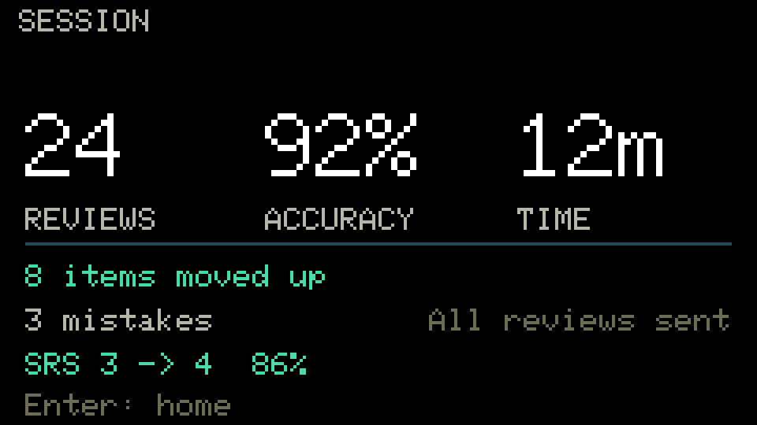

- Header `SESSION`.
- Three columns at x=8/84/164 with 32 px values and 8 px labels:
  - `REVIEWS`: completed reviews.
  - `ACCURACY`: final correct answers / (final answers + wrong attempts),
    rounded. Each required meaning/reading part counts once.
  - `TIME`: elapsed wall-clock time, e.g. `42s`, `12m`, `1h 5m`.
- Divider, then:
  - `8 items moved up` in green, or `No stage changes` in faint. A successful
    `POST /reviews` counts only when its new stage is above the stage recorded
    when the review was queued; the response carries the new stage, not the old
    one.
  - `3 mistakes` on the left and the outbox state on the right: `4 pending` in
    amber, `1 need attention` in red (rejected + stuck), or `All reviews sent`
    in faint.
  - The item line combines two sources. The stage comes from the last
    successful `POST /reviews` (`gStageChange`; its previous stage comes from
    the session's `StageTracker`), while the lifetime accuracy/history comes
    from the last completed item (`gCompletedItem`). They can differ when that
    item's POST is still pending. Examples: `SRS 3 -> 4  86%`, `SRS 3  86%`,
    or `History 18 reviews, 89%`.
- `Enter: home`.
- **SPEED-01 submission (2026-11-19).** With R12 `At session end` (default) or
  `Every 5`, the summary may run a send loop: the outbox line becomes
  `Sending 3/12`, a 3 px bar at y=121 fills, and `N items moved up` plus the
  outbox count update after each item. `Esc: stop` leaves the rest pending for
  the next sync. `Every 5` shows `Sending n/5` on the review hint bar after the
  5th/10th completion; `Immediately` keeps one POST per completion. **Hardware
  pending:** the summary loop, `Esc` stop, offline/Every-5/Immediately and heap/
  canvas (see [`docs/hardware.md`](hardware.md), 2026-11-19).
- **REV-11 mistakes list (2026-11-19).** The summary footer is
  `Enter: home  R: next batch` while due reviews remain; `Down`/`Tab` opens a
  three-row list (`1-3/7`) with the prompt character, primary meaning and
  reading, wrong counts or the last wrong text and `SRS 3->4`/`pending`.
  `Up`/`Down` wrap, `Esc` returns to the stats and `Enter` still goes Home; an
  empty list reads `No mistakes`. `R` starts another batch without returning
  Home; it is absent with no due reviews and in practice. **Hardware pending:**
  the list/navigation, `R`, stage updates during the send loop and the 240×135
  layout (see [`docs/hardware.md`](hardware.md), 2026-11-19).

- **Sound (REM-03, 2026-11-20; hardware pending).** With M4 On, the summary
  plays a three-note figure once when it opens, and only after at least one
  review was completed; an empty session is silent. It starts after the send
  loop, so it is not held up by a POST.

**Implementation note (2026-10-28).** The values use the built-in 32 px font
and fall back to 16 px if one would cross its column. Accuracy and duration
live in native-tested `wk/SessionStats.h`; the session start is a `millis()`
timestamp and the final duration is latched when the summary opens. It is not
persisted. Offline completions do not count as stage changes because there is
no POST response; they still become `gCompletedItem` and can update the
history/accuracy side of the item line.

### 5.8 Lessons

- `LESSONS` with a list of available items: character, type, level, main
  meaning.
- `↑↓` moves, `Enter` opens, `Esc` goes back.
- Each row: `休 · KANJI · L5 · rest`.
- If there are no lessons: `No lessons now` + the next review time from
  `/summary`; the next unlock is not known to v1.
- `Space` toggles a row into the batch (at most the configured size); `Enter`
  studies the selected batch. The list hint is `Space: select  Enter: study`.

**Implementation (2026-11-19, LES-01…06).** The list and picker are live: a
scrolling list of up to the configured batch, ordered by L2 (WaniKani,
`Radicals>Kanji>Vocab` or `Interleave types`), with the first N rows selected.
`Space` toggles a row up to the batch limit, `Enter` opens the cards, and
paging never calls `PUT /start`; after the last card the batch quiz (L3
`Required` by default) and one confirmation start the whole batch. The device
reads up to 60 summary candidates, fetches their assignments and base subject
levels in bounded pages, sorts the whole pool and only then trims to the batch
size. L4/L5/L6 run before Wi-Fi or the low-battery prompt and can open
`WORKLOAD CHECK` with one reason per exceeded threshold (`Apprentice items: 150
(limit 100)`); `Enter` continues and `Esc` returns Home without a fetch. A card
is split into `Meaning`, `Reading` (skipped when the subject needs none),
`Components and notes` and `Context` (only when parts of speech or sentences
exist); a long topic repeats its title on further pages, and the header `pN/M`
counts the drawn pages. The first hardware card showed `p1/6` and `p2/6
READING`. **Hardware pending:** the full quiz with mistakes, offline start, 422,
L3 `Skip`, the 60-candidate order, the multi-reason guard, L5/L6 and a
radical/vocabulary page set (see [`docs/hardware.md`](hardware.md), 2026-11-19).

### 5.9 Lesson card

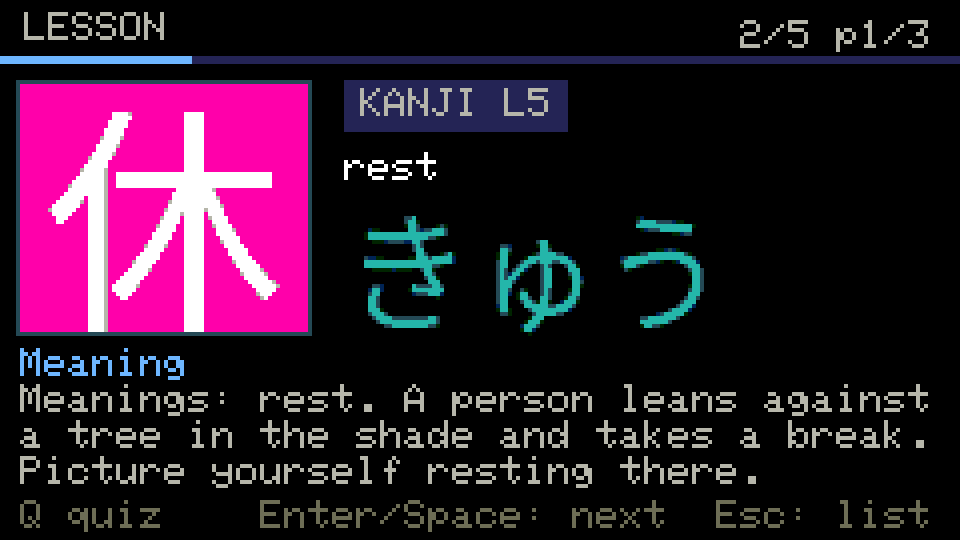

- Header `LESSON`: item position `2/5` and mnemonic page `p1/3` are
  right-aligned on the same row. This screen has no Wi-Fi/battery icons.
- A live 2 px progress bar at y=14 shows the completed lesson items; the card
  starts at y=20.
- Left panel: character/radical scaled to fit the 74×64 panel (64 px preferred).
- Right: pill `KANJI L5`, the main meaning in the 6×8 font, readings in teal at
  32 px (20 px fallback); component meanings are part of the paged text.
- Each topic page shows its title and up to three 6×8 lines at 9 px pitch; a
  long topic continues on the next page with the title repeated. The page count
  is clamped to the drawn pages.
- `Q quiz` opens the optional single-item local quiz.
- `Space`/`Right` page forward; `Enter` also advances to the next card when
  already on the last page. `Left`/`Backspace` page back or move to the previous
  card on page 1; `Esc` returns to the list with the batch intact. Nothing is
  sent while browsing.
- Bottom hint: `Q quiz` left and `Enter/Space: next  Esc: list` right at y=125,
  with a gap between them.
- After the last card, the batch quiz runs (default) or the start confirmation
  follows when L3 = Skip. The card itself only reads until the last page.
- The start confirmation reads `Start N lessons? They join your reviews in
  about 4 hours.`; `Enter` starts the batch and `Esc` goes back to the last
  card. `Starting 2/5` is drawn per request; 422 counts as started and any
  other failure keeps the unstarted items (§4.4).
- **Implementation (2026-11-19, LES-01/02/03).** The batch flow above is live;
  the card never sends `PUT /start`. The start confirmation and per-item
  progress appear after the quiz. **Hardware pending:** the full quiz with
  mistakes, offline start, 422, L3 `Skip` and the visual checks (see
  [`docs/hardware.md`](hardware.md), 2026-11-19).

### 5.10 Lesson quiz

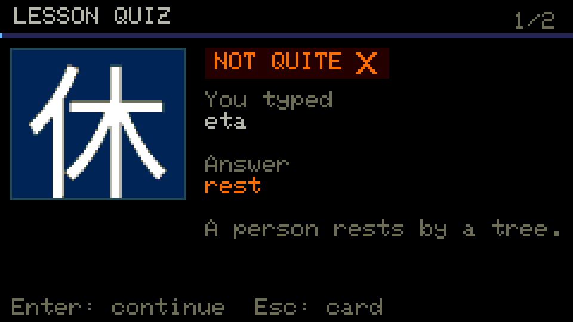

- `Q` on a lesson card opens the optional single-item local quiz. The batch
  quiz after the last card is the gate by default (L3 `Required`); L3 `Skip`
  goes straight to the start confirmation.
- Both quizzes use the review answer field: header `LESSON QUIZ`, `1/2` (or
  `1/1` for radicals), meaning first, then reading when the subject has one.
- Typed answers use the same romaji-to-kana input and answer checker as reviews.
- Wrong answers show `NOT QUITE` with a cross icon, the accepted answer list
  and are retried; a mistake count is kept. Warnings show `CHECK` (no icon)
  and retry the same part without showing the typed or answer row; the hint
  reads `Enter: edit  Esc: card`, and the typed text (meaning string and IME
  raw buffer) is kept for the retry. A completed part keeps the same `CORRECT`
  pill and check icon as §5.5.
- The quiz feedback body is the same scrolling body as §5.5 (x 86, 150 px wide),
  with Up/Down to scroll and `;/. scroll` in the hint when it overflows. The
  quiz has no auto-advance, so scrolling changes nothing else.
- In the batch quiz, a wrong part requeues until every required part is correct;
  `Esc` returns to the last card with the batch unchanged. After the last part
  the start confirmation follows.
- The `Q` quiz completion shows `Practice complete`, the mistake count and
  `No /start sent.`; `Enter` returns to the card. `Esc` also returns to the card.
- Neither quiz calls `PUT /start`; only the confirmed batch start in §5.9
  writes. **Hardware pending:** the full batch quiz with mistakes and the
  lesson-quiz look (see [`docs/hardware.md`](hardware.md), 2026-11-19).
- **Implementation (2026-11-19, LES-02).** After the last card, `Enter` starts
  a quiz over every selected item, shuffled, with meaning first and reading
  where the subject has one. Wrong parts requeue; `CHECK` retries the same part.
  The L3 setting (`Required` / `Skip`) is live; `Q` remains single-item
  practice. The quiz never writes; the start confirmation follows.

### 5.11 Sync

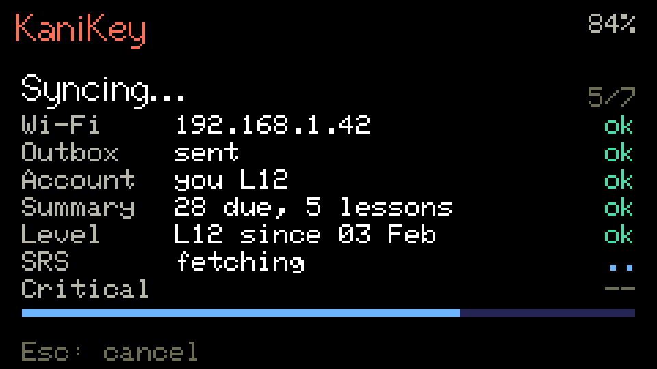

- Automatic sync (boot or wake) is a background job: Home stays visible, the
  header shows `sync n/m` instead of `Synced HH:MM`, and one request runs per
  loop pass. `Enter` starts a cached review at the next step boundary; `Esc`
  opens Settings; the job pauses while another screen owns the display
  (SPEED-03). It is skipped when the last successful sync is under five minutes
  old (SPEED-02).
- A manual sync (`S` on Home, Settings › `Sync now`, or a retry) always runs
  Full and replaces Home with the screen below. `Esc` cancels at the next step
  boundary.
- The plan is Quick or Full (SPEED-02). Quick = Wi-Fi, time, outbox and
  `/summary`; `/user` only on a cold boot or when the last `/user` is 6 h old.
  Full = Quick plus level progress, the SRS counts and Critical. A full
  automatic sync also prefetches the review batch when reviews are due, the
  cached batch is shorter than R1 and the battery is not low (SPEED-04).
- The manual screen has seven rows: `Wi-Fi`, `Outbox`, `Account`, `Summary`,
  `Level`, `SRS`, `Critical`. The Critical row is non-blocking: a missing
  permission or network error shows `unavailable` and keeps the previous list.
- The `Outbox` row shows pending and attention separately (`2 attention, 4
  pending`), or `N need attention` / `N pending`; `none` before a flush and
  `sent` when both are zero afterwards.
- Each row shows a name, a value and a status: `ok` in green, `..` while
  active, `!` for a warning, `X` for a failure and `--` while pending. The
  10 px rows stay text-only; an 11 px icon would not fit.
- Progress bar `0/7` … `7/7`; the title reads `Syncing...`, `Synced` or
  `Sync failed` and carries the sync, check or cross icon after the word.
- `Esc` cancels at the next step boundary. Completed requests are kept, and
  the device returns to Home (or to boot with `Sync cancelled` if there is no
  cache).
- A failed Account or Summary request stops the later steps and leaves the
  screen on `Sync failed` with the error line. `Enter` retries; for a token or
  permission error `Enter` opens setup. `Esc` goes back.
- A failed Level, SRS or Critical request is not a blocker: the sync completes
  and keeps the previous cached data. It shows `!` when the step reports a
  warning; a still-valid cached Level value can remain `ok`.
- The rows are drawn between the blocking TLS requests, so a cancel pressed
  during a request takes effect when it finishes.
- A sync step, batch/lesson fetch or outbox flush reuses one TLS connection
  (SPEED-05); the sync screen does not pay a handshake per request. The
  remaining chunked/timing/heap checks are in `docs/hardware.md`.
- SNTP starts with the stored POSIX rule (`configTzTime`), so Home `Synced
  HH:MM`, `Next review` and the level date are local time. Changing the zone in
  Settings applies at the next sync without a reboot.

### 5.12 Settings

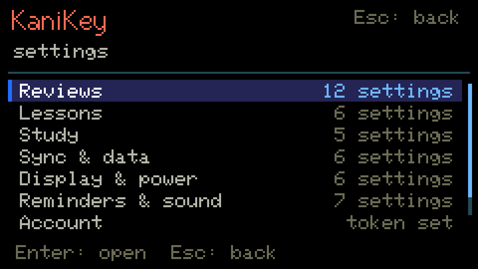
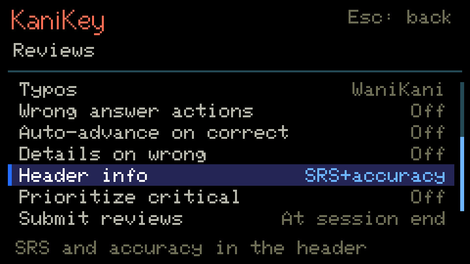
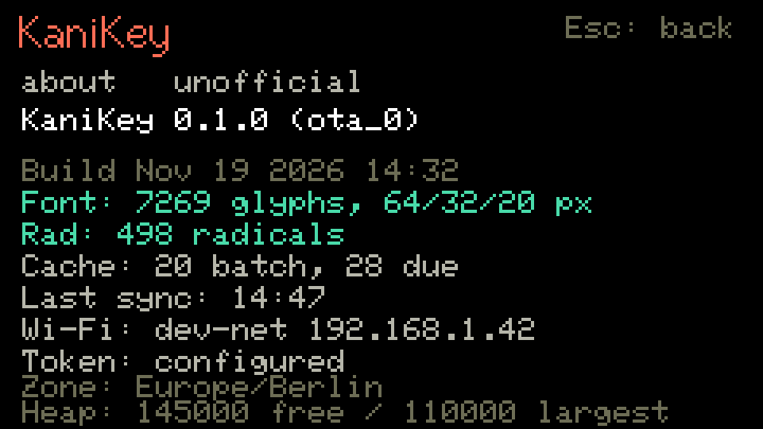

- Open with `Esc` from Home, or `Esc` in a review → Pause → Settings.
- Settings is the eight-section menu: `Reviews`, `Lessons`, `Study`,
  `Sync & data`, `Display & power`, `Reminders & sound`, `Account`, `System`;
  each section row shows a short summary (`12 settings`, the Account token
  state). The 7-row window and scroll bar stay. The authoritative IDs, labels,
  choices, defaults and NVS keys are the registry in
  [`03-settings.md`](spec/03-settings.md); this file does not duplicate them.
- `↑↓` moves, `Enter`/`Right` selects the next value, `Left` the previous, both
  wrapping; `Esc` pops one level (section → top → origin, Home or Pause). The
  bottom line shows the focused row's registry help; a transient note replaces
  it until the selection moves. A change writes NVS once and applies without a
  reboot; nothing here calls WaniKani.
- The registry holds 48 rows (39 keyed settings and 9 actions): Account has
  `Wi-Fi`, `Setup portal` and `Sign out`, and System has three actions. R5
  `Back-to-back` (On), R8 `Auto-advance on correct` (Off) and R10 `Header info`
  (SRS+accuracy) are live and hardware pending; R6 `Typos` now selects
  WaniKani/Strict in reviews and both lesson quizzes; R7 `Wrong answer actions`
  (Off) adds C/A, R9 `Details on wrong` (Off) opens the failed mnemonic, R11
  `Prioritize critical` (Off) moves due critical items first, and R12 `Submit
  reviews` chooses when completed reviews are POSTed; R2/R3 order and group the
  due set before the batch limit. R4's `Random` value is stored but the
  first-question build still treats it as Meaning (the R2 `Random` order is
  separate). L2 `Order`, L4–L6 and the other keyed rows are live where
  `03-settings.md` says so; P5–P6 still await their owner and M4–M7 are live. The
  current build reads R1–R12 (R4 only Meaning/Reading), L1–L6, S1–S5, Y1–Y3,
  P1–P4, M1–M3 and the nine actions.
- **M1–M3 Reminders (REM-02, 2026-11-20; hardware pending).** M1 `Reminder`
  (`Off`, `1+ due`, `10+ due`, `25+ due`, `50+ due`; default Off) sets the
  review count that reminds, and its review-bucket wake is armed only while it
  is on. M2 `Quiet hours` (`Off`, `22-08`, `23-07`; default `22-08`) keeps
  reminders out of the span, which wraps midnight; a wake inside it moves to
  the end of the span. M3 `Daily reminder` (`Off`, `08:00`, `12:00`, `18:00`,
  `20:00`; default Off) adds a daily wake at that local time; with M1 Off it
  reminds when anything is due. With M1 and M3 both Off the device arms no
  timer and sleeps as before. The banner is described at §5.3.
- **Implementation (2026-11-20, REM-02).** The schedule is pure
  (`wk/Reminder`); the device side keeps the clock in RTC memory and arms the
  timer in the idle deep sleep only. **Hardware pending:** the timer wake with
  Wi-Fi off, the 30 s expiry, the key path and the banner text (see
  [`docs/hardware.md`](hardware.md)).
- **M4–M5 Sounds (REM-03, 2026-11-20; hardware pending).** M4 `Sounds` (`Off`,
  `On`; default Off) turns on the answer tones (§5.5), the session-end figure
  (§5.7) and the reminder chime that plays when the M1–M3 banner shows. M5
  `Volume` (`Low`, `Medium`, `High`; default Medium) sets the level; it applies
  to the next tone, with no reboot. Off plays nothing anywhere, and nothing
  plays during a sync or in the setup portal.
- **M6 Autoplay audio (AUD-03, 2026-11-20; hardware pending).** M6 `Autoplay
  audio` (`Off`, `On`; default Off) plays a vocabulary clip once on its own at
  two points: the reading feedback after a checked answer (Correct or Incorrect;
  the typo Warning stays silent), and the lesson card's first view of a subject
  that has a reading. It plays the same clip as `R` (M7 voice, the other voice
  as fallback). With no cached MP3 nothing plays and nothing is requested, and
  nothing plays during a sync or in the setup portal. When M4 Sounds is on, the
  clip starts after the answer tone ends; a tone never cuts it off and no key
  waits for it. Any key stops or cancels it, as with `R`. A clip the speaker
  cannot start (low heap) is skipped for that view, without `no audio`; `R`
  still tries. Off changes nothing.
- R2 `Account preference` reads WaniKani's `reviews_presentation_order`; there
  is no separate toggle for that preference. The other R2 orders are
  device-side and do not change the account setting.
- `Setup portal` reopens the Wi-Fi/token/time page; it and `Wi-Fi` are disabled
  during a review so the session is not lost. `Sync now` starts a manual full
  sync; `Outbox` opens the list even when nothing needs attention.
- About shows the firmware version and slot, build date, an update badge when
  one is known, the font and radical pack status, cached batch, last sync,
  Wi-Fi, whether a token is configured, time zone and heap. The `Font:` and
  `Rad:` lines carry the SD icon and `Token:` the key icon, in the line colour;
  the other lines stay text-only.
- `Firmware` shows the running version/slot, the last check or install result
  and `Check now` / `Install update` rows. Install asks for a second `Enter`,
  then streams the image and restarts. A failed check stays on the screen with
  its HTTP/TLS reason; a failed install keeps the current image.
- `Clear cache` removes the snapshot, subjects and cached audio for the next
  boot; `Sign out` confirms, then removes the token, cache and pending outbox
  and keeps Wi-Fi.
- `System › Reset settings` asks for a second `Enter`, then erases only the
  registry keys (and the legacy `order` key), redraws every default and applies
  brightness and the timers at once. Token, Wi-Fi, time zone, cached batch and
  outbox survive; the device does not restart.
- Licenses and attributions are in `LICENSE` and `THIRD_PARTY_NOTICES.md`; the
  About header marks the app as unofficial.
- **Implementation (2026-11-19, CFG-01/02/03).** The sectioned menu above is
  live, backed by the 48-row registry. The disruptive rows (`Wi-Fi`,
  `Setup portal`, `Firmware › Install update`, `Sign out`, `Clear cache`,
  `Reset settings`) are faint and inert during a review. **Hardware pending:**
  the review lock,
  `Reset settings`, origin return, scrolling/clipping and upgrade values; the
  2026-11-19 log records the eight sections and one `Batch size` cycle (see
  [`docs/hardware.md`](hardware.md), 2026-11-19).
- **CFG-04 key help (2026-11-19).** `Shift`+`/` (`?`) opens a per-screen table
  on Home, Settings, reviews, lessons, Outbox and Firmware: title, key chord
  left, action right, at most seven rows and `Esc: close`. `Esc` closes and no
  key reaches the screen underneath; the overlay is refused during the setup
  portal, on-device Wi-Fi, low-battery, sign-out, About, Pause, Stats, Study,
  Sync, notices and the screens without a table (summary, lesson list/empty,
  item detail). Plain `/` is still Right and `?` works inside an answer field.
  **Hardware pending:** the lesson/Outbox/Firmware tables, the swallow/close
  path, plain `/` paging and the portal/Wi-Fi refusal (see
  [`docs/hardware.md`](hardware.md), 2026-11-19).

### 5.13 Outbox

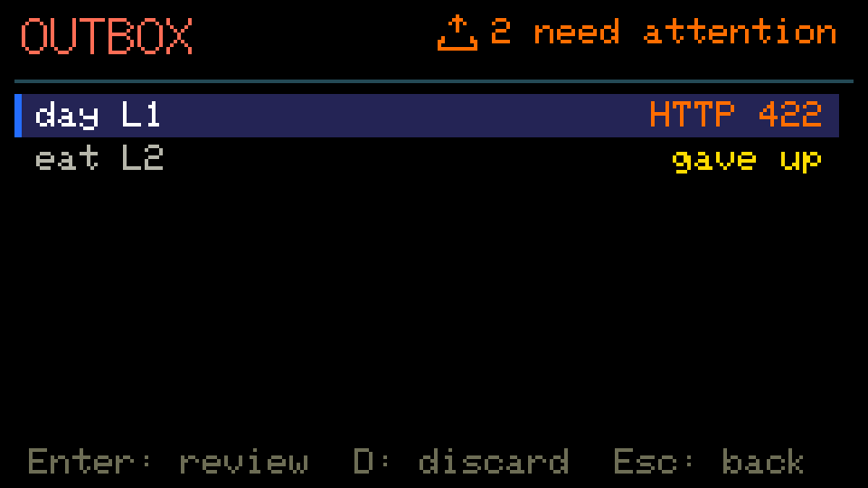

- Open with `O` from Home when at least one review was rejected or gave up; the
  key is ignored when nothing needs attention.
- Header `OUTBOX` and `N need attention`; the outbox icon sits before the
  right-aligned count. `rejected` and `stuck` items are listed. Pending,
  sending and ambiguous items are not.
- Up to seven visible rows scroll with `↑↓`. A row shows the subject's English
  main meaning and level (for example `day L1`) when it is still in the cached
  batch, otherwise `assignment <id>` (or `subject <id>`). The reason is
  right-aligned: `HTTP 422`, `HTTP 409`, `rejected` when the code is unknown, or
  `gave up` for a stuck item.
- `Enter` (the bar still says `Enter: review`) or `D: discard` opens the
  discard confirmation; `Esc: back` returns to Home.
- Confirmation shows the same identifier and the reason. Rejected items keep
  `WaniKani rejected this review (HTTP 422).`, `Conflict (409); it may have
  changed.` or the generic fallback; stuck items show
  `Not sent after N attempts.` Both add the attempt count and the created age
  (`just now`, `2h`, `3d`, or `age unknown` when `created_at` is 0 or the clock
  is untrusted). It also warns that dismissing only removes the local unsent
  review and does not change WaniKani.
- `Enter: discard` removes exactly that sequence, saves the outbox and returns
  to the list, or to Home when no rejected/stuck items remain. `Esc: cancel`
  returns to the list. Pending, sending and ambiguous items are never removed
  here, and the cache/assignments are not touched. If the outbox file cannot be
  written, the item stays and the screen shows `Could not save outbox`.
- A completed review is queued and saved before its feedback frame is drawn, so
  a reboot or an OTA install on the feedback screen keeps it. `Enter` sends it
  once; it is never added twice.
- Starting a session needs as many free slots as the batch size (all states
  count, 128 total). Otherwise the device shows `Outbox full` with
  `Enter: sync  Esc: home` instead of starting. Home appends `(nearly full)`
  above 75% (§5.3).

### 5.14 Stats

- `T` on Home opens a read-only `STATS` screen; `Esc` returns Home. `←`/`→`
  move between the four pages, clamped at the ends. Header `STATS 1/4` and
  hint `Esc: back  Left/Right: page`.
- Page 1 `Forecast`: 24 one-hour bars for the next 24 h, starting with the
  current hour, built from cached `/summary` buckets. Every six hours a local
  time label (`00`, `06`, `12`, `18` style) sits under the axis. With no future
  bucket the page reads `No reviews in the next 24 h`. It makes no request.
- Page 2 `SRS`: Apprentice/Guru/Master/Enlightened/Burned counts and
  proportional bars using the Home colours. Without cached counts it reads
  `Sync for counts`.
- Page 3 `Level`: `Level N`, days on the level, `kanji 12/34 (35%)` when the
  counts are known, `Need 12 kanji for 90%` or `90% reached`, and
  `A 42 total` from the cached account-wide Apprentice count (`A -- total`
  when unavailable). Missing data omits the line instead of inventing a value.
- Page 4 `History`, subtitle `On this device`: seven bars for the last seven
  local days (today last), weekday labels and counts, then
  `Today 86%  Streak 6  Best 21`. `Today -` means no review was recorded today;
  the current streak is counted from yesterday in that case. The best streak
  scans the last 400 recorded days, which bounds screen RAM on the device. An
  empty journal shows `No reviews on this device yet` with zero streaks. The
  data comes from `/state/journal.bin`; `/reviews` is deprecated and never
  called.

### 5.15 Extra study

- `P` on Home opens `EXTRA STUDY`: `Recent mistakes`, `Recent lessons`,
  `Critical items`, `Current level`. `↑↓` moves, `Enter` opens/starts,
  `Esc` returns Home.
- Recent mistakes uses the configured journal window (default 24 h) and ignores
  practice records. Recent lessons uses the persisted apprentice pool with the
  configured window; Current level uses apprentice kanji of the current level.
  The pool is refreshed on sync, so both modes work offline; if it is empty and
  Wi-Fi is available they fetch once and save it.
- `Critical items` opens `CRITICAL ITEMS`, worst first, with prompt, main
  meaning and percentage. Up/Down scrolls, `Enter` opens the detail card,
  `P` starts practice, `Esc` returns to the menu.
- Practice reuses the review UI. It never writes the outbox, never calls
  `POST /reviews` or `PUT /start`, and never changes due counts or SRS. Each
  completion is journaled with `practice=true`.
- The summary header is `PRACTICE`, with `Nothing was sent to WaniKani` and
  `N items skipped` when subjects were unavailable. `Enter` returns Home.
- Empty modes stay in the menu: `No recent mistakes`, `No recent lessons`,
  `No critical items`, `Current level complete`, or
  `Nothing cached for this mode`.

### 5.16 Errors and empty states

- **Not configured:** Boot `Token needed` + `Enter: setup`; Boot `Wi-Fi needed`
  offers `Enter: on-device  P: phone`.
- **No SD:** `No SD card` + `Insert a FAT32 card with /kanikey/glyphs.kgp` +
  `Enter: retry`.
- **Visual pack:** `Pack missing` + `Press Enter to download it` + `from the
  setup page` + `Enter: setup`. A missing radical pack is not a boot error; its
  prompts show `no glyph` / `no radicals` or `not in pack`.
- **No network:** Home status `Offline - ...` with cached data and `S: sync`;
  without a cache, Boot `Sync failed` with the network line + `Enter: retry`.
- **Token:** Home `Auth: token rejected`; Boot `Token rejected` + `Enter:
  setup`.
- **Permissions:** Home `Auth: missing permissions`; Boot `Missing permissions`
  + `Enter: setup`.
- **Rate limit:** Home `Rate limited; retry in 42s`; Boot `Rate limited` +
  `Retry in 42s`.
- **Server:** Home `WaniKani error; retry`; Boot `WaniKani error` + `Enter:
  retry`.
- **Empty:** the counters show `0` and `Next review` shows the next time (or
  `all clear`). `Enter` on Home with nothing due opens `No reviews now` with
  `Next review HH:MM` and `Enter: sync  Esc: home`; no request is made. An
  empty review queue after `Starting session...` shows the same frame instead of
  leaving the wait screen up.
- **Review fetch:** `Could not load reviews` with the network line and
  `Enter: retry  Esc: home`.
- **Lesson fetch:** `No lessons available` with the error line and
  `Enter: retry  Esc: home`.
- **Storage:** a LittleFS mount failure never formats on its own. The device
  shows `Storage unreadable` / `Pending reviews cannot be read.` /
  `Enter: format  Esc: continue`. `Enter` formats and loads the outbox;
  `Esc` continues without storage (no outbox and no cache writes) and Home
  shows `Storage unavailable`.

Error screens never show stack traces, URLs with a token, or JSON.

---

## 6. Accessibility

- **Contrast:** main text on background > 15:1; secondary text > 7:1;
  semantic colors are accompanied by the pill and a word; check/cross icons
  are supplementary and never the only signal.
- **Color blindness:** green and red aren't the only signal; the pill, the
  word and, where present, the icon change.
- **Size:** the UI text is the 6×8 GLCD font (8 px cell); 32 px counters and
  summary values, and 32/20 px Japanese readings. Long text is wrapped or
  paged, never shrunk below the 6×8 cell.
- **Keyboard:** everything can be done without touching the screen; there are
  no gestures.
- **Movement:** only the caret and progress; no animations that block.
- **Language:** English. Meanings/readings are always WaniKani's (English).
- **Long text:** it paginates; Latin text stays at the 6×8 font and Japanese
  text uses the pack's 20 px fallback.

---

## 7. Copy and tone

- Short, direct, without WaniKani jargon.
- “Correct” / “Not quite”, not “Well done!” or “You got it wrong”.
- “Reviews”, “Lessons”, “Meaning”, “Reading”, “Item”, “Session”.
- “Offline - 2h old” and “Outbox: 4 pending”, not “Network error”.
- “Comes back later in this session”, not “Incorrect. It will be repeated”.
- Disclaimer in Setup and About:
  `KaniKey is an unofficial third-party app for WaniKani. Not affiliated with
  WaniKani or Tofugu LLC.`

---

## 8. Mockups

All images in `docs/screens` are **renders**, not device captures. They are
generated from the firmware's screen layouts with the M5GFX bitmap fonts and
the RGB332 palette; Japanese glyphs are a Noto Sans JP stand-in for the pack.
The renders draw the same 11×11 1bpp icons as `firmware/src/ui/Icons.h` in the
adopted slots. The panel/gamma check for every icon is pending.

| File | Screen | Source |
|---|---|---|
| `screens/home.png` | Home with reviews, lessons and SRS distribution | render |
| `screens/home-outbox.png` | Home with outbox attention and its hint variant | render |
| `screens/outbox.png` | Outbox with the attention header and two rows | render |
| `screens/review-meaning.png` | Meaning question | render |
| `screens/review-reading.png` | Reading question with romaji | render |
| `screens/review-correct.png` | Correct feedback with accepted answers | render |
| `screens/review-wrong.png` | Incorrect feedback with the hint sentence | render |
| `screens/review-check.png` | Typo warning (`CHECK`) | render |
| `screens/lesson.png` | Lesson card with the topic title | render |
| `screens/lesson-quiz.png` | Lesson-quiz wrong feedback with the cross icon | render |
| `screens/summary.png` | Session summary | render |
| `screens/sync.png` | Synchronization | render |
| `screens/settings.png` | Settings, eight sections | render |
| `screens/settings-reviews.png` | Settings › Reviews options | render |
| `screens/setup.png` | Setup access point | render |
| `screens/setup-station.png` | Setup station with font and radical status | render |
| `screens/wifi-scan.png` | On-device Wi-Fi scan | render |
| `screens/wifi-password.png` | On-device Wi-Fi password | render |
| `screens/about.png` | About with split pack status | render |
| `screens/overview.png` | Contact sheet of all | render |

To regenerate them:

```sh
uv run --with pillow python3 tools/mockups/render.py
uv run --with pillow python3 tools/mockups/render.py --check
```

The script uses Noto Sans JP only for the Japanese pack stand-in. It looks for
the font in `tools/pack-builder/cache/noto/` or Tangocho's cache, or at
`KANIKEY_FONT`. The setup renders use a placeholder `KaniKey-4F2C` AP and a
synthetic `dev-net` station, not real credentials. Device captures are made
separately with `tools/shot.py` and are not committed when they contain user
content.
