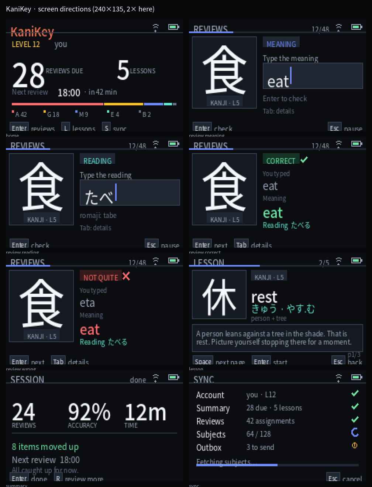
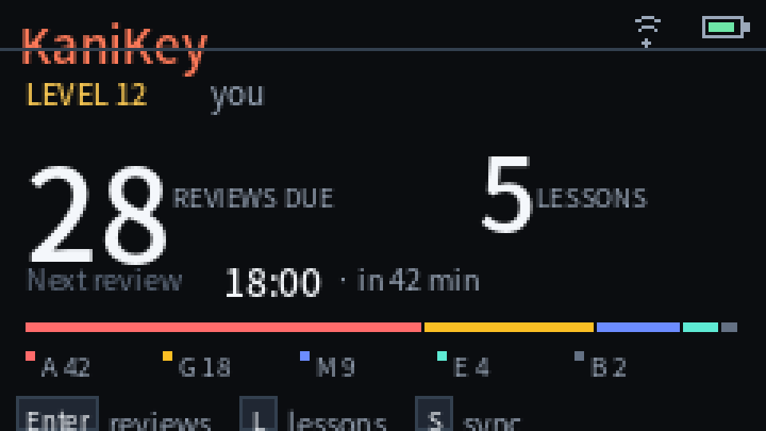
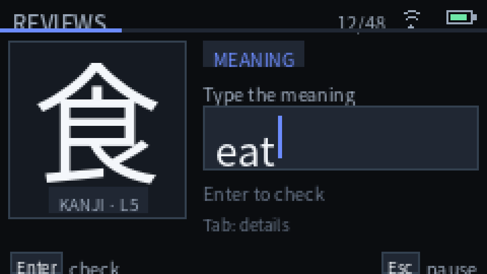
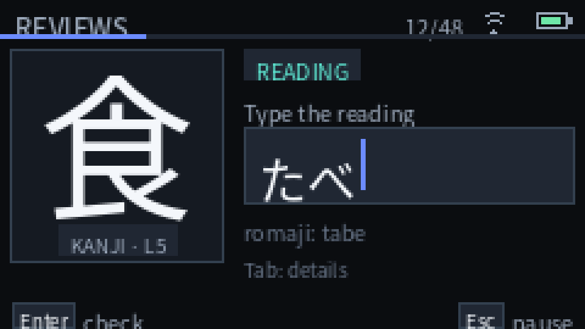
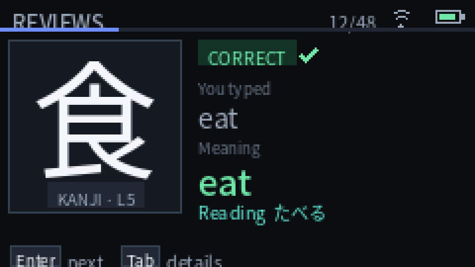
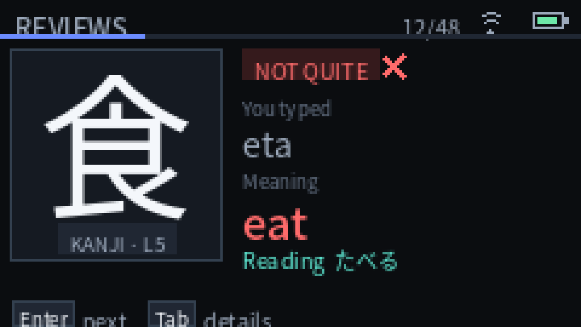
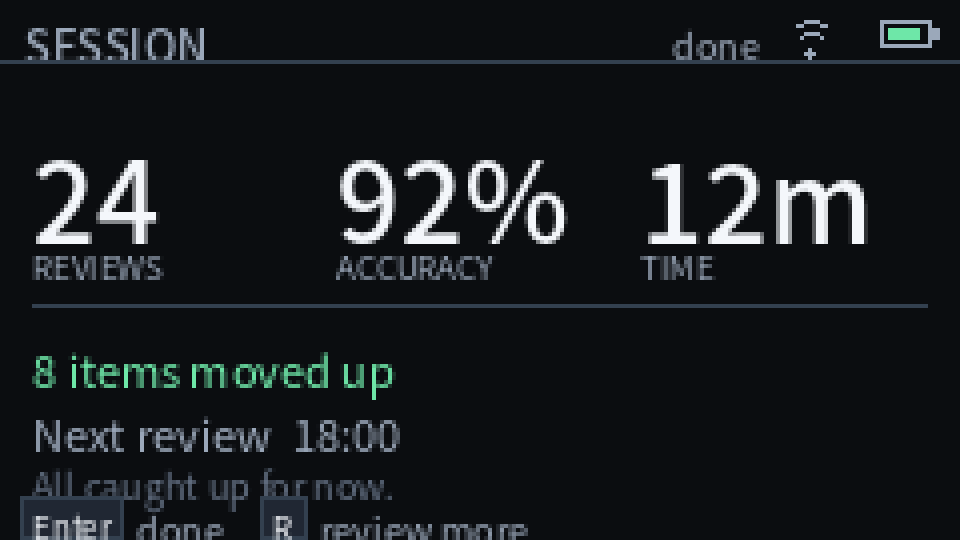
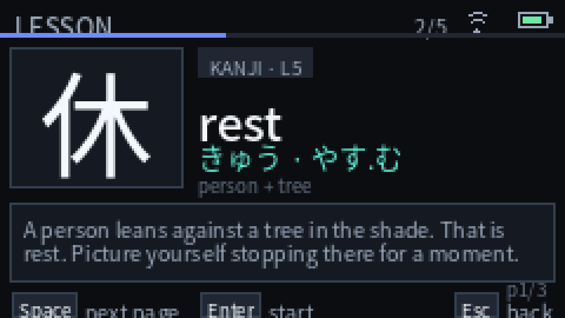
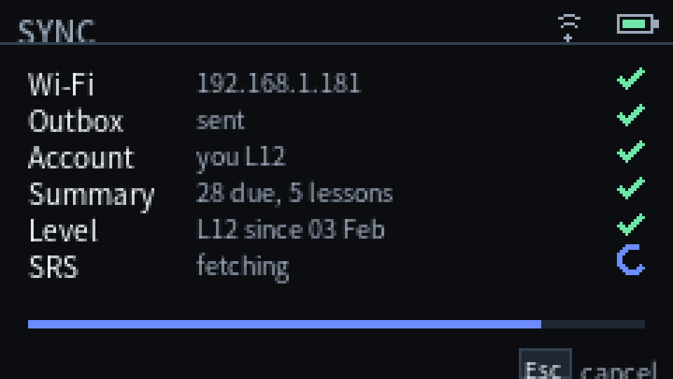
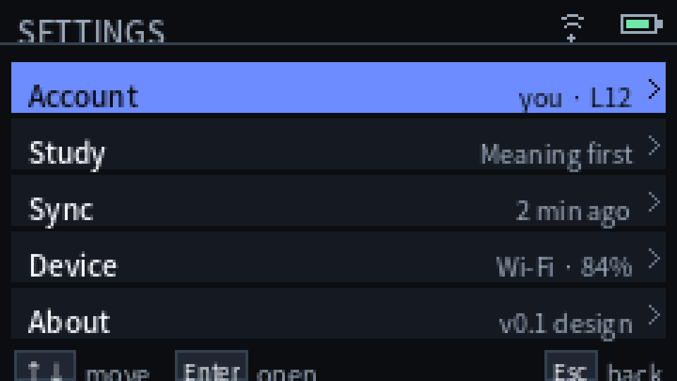

# KaniKey — UX, keyboard and screens

> Design, 2026-10-25. Mockups are at 240×135: individual ones are shown at 4×
> and the contact sheet at 2×. Geometry and text sizes are the 1× ones; the
> upscale is nearest-neighbour so as not to misrepresent the pixel grid.



---

## 1. Principles

1. **The keyboard is the interface.** Typing an answer isn't an odd mode: it's
   the main action. The rest of the app is navigated with arrows and Enter.
2. **One focus per screen.** In the review, the item and the answer. On home,
   the reviews. In the lesson, the mnemonic. Nothing competes.
3. **The bottom bar always says what the keys do.** There are no invisible
   shortcuts. If a key changes meaning, the bar changes.
4. **Color + shape + word.** Correct isn't just green; it has ✓ and the word
   `CORRECT`. Incorrect isn't just red; it has ✗ and `NOT QUITE`.
5. **Offline is stated.** An icon, a word and a number: `Offline · 18 cached ·
   4 to sync`. Never a generic error.
6. **Short texts.** The screen is 240×135; long sentences wrap onto several
   lines or move to a detail screen.

---

## 2. Visual language

### 2.1 Palette

| Token | Hex | Use |
|---|---|---|
| `bg` | `#0B0D10` | Background |
| `surface` | `#151A22` | Panels, rows, cards |
| `surface-hi` | `#202733` | Answer field, pills, hints |
| `line` | `#33404F` | 1 px borders, separators |
| `text` | `#F4F7FB` | Main text, kanji |
| `text-dim` | `#9BA8BA` | Secondary text, labels |
| `text-faint` | `#647184` | Metadata, help |
| `accent` | `#6C8CFF` | Focus, progress, `MEANING` |
| `accent-hi` | `#9DB2FF` | Accent on black |
| `brand` | `#FF7A59` | Brand, logo, details |
| `reading` | `#5EEAD4` | Readings, `READING` mode |
| `ok` | `#6EE7A8` | Correct |
| `ok-bg` | `#123326` | Correct background |
| `err` | `#FF6B6B` | Wrong |
| `err-bg` | `#351A1C` | Wrong background |
| `warn` | `#FBBF24` | Warnings, offline, low battery |
| `gold` | `#F5C451` | Level |

The palette is its own: warm black, indigo and coral. WaniKani's colors,
illustrations and components are not copied.

### 2.2 Typography

| Role | Size | Use |
|---|---|---|
| Display | 32 px | Big numbers: reviews, accuracy, time |
| Prompt | 64 / 48 / 32 px | Kanji, radical, vocabulary word |
| Answer | 20 px | Written answer, meaning/reading |
| Title | 18 px | Lesson title, main meaning |
| Body | 14 px | Sentences, mnemonics, values |
| Caption | 10 px | Labels, header, pills |
| Micro | 9 px | Metadata that isn't essential |

The UI uses **Noto Sans JP** (OFL) for Latin and kana; kanji/vocabulary come
from the visual pack. In the firmware, the UI font is pre-rendered as in
Tangocho (`UiFont.h`), so there's no rasterization on the device.

### 2.3 Grid

- Base unit: 4 px.
- Margins: 4 px.
- Header: 16 px (title + 2 px progress or a 1 px line).
- Hint bar: 12 px.
- Pills: 13 px high.
- Answer field: 32 px high.
- List rows: 18–20 px.
- Square corners; no shadows; 1 px borders.

### 2.4 Components

- **Header:** title or brand on the left; Wi-Fi icon, battery and a value on
  the right; 2 px progress bar at the bottom in the review.
- **Pill:** short uppercase label (`MEANING`, `READING`, `CORRECT`,
  `KANJI · L5`) with a `surface-hi` background and semantic color.
- **Input:** `surface-hi` rectangle with a `line` border; 20 px text; 2 px
  caret in `accent`; 2 px `accent` border when the keyboard is in text mode.
- **Keycap:** 11 px square with a border; the key in 8 px; the action next to
  it in 9–10 px.
- **Progress:** 2–3 px bar; `surface-hi` track, `accent` fill.
- **Feedback:** pill + icon + word; never color alone.
- **List row:** `surface` background, `accent` focus, 10 px label, 9 px value,
  chevron.

---

## 3. Keyboard

### 3.1 Physical map

The Cardputer ADV has 4 rows × 14 keys. The main layer is US; Shift gives
uppercase and symbols; Fn gives function.

```
  `  1  2  3  4  5  6  7  8  9  0  -  =  del
 tab q  w  e  r  t  y  u  i  o  p  [  ]  \
 fn  sh a  s  d  f  g  h  j  k  l  ;  '  enter
 ctrl opt alt z  x  c  v  b  n  m  ,  .  /  space
```

| Key | Normal layer | Shift | Fn |
|---|---|---|---|
| `` ` `` | `` ` `` | `~` | `Esc` |
| `1`–`0` | digits | `!@#$%^&*()` | `F1`–`F10` |
| `-` / `=` | `-` / `=` | `_` / `+` | `F11` / `F12` |
| `del` | Backspace | Backspace | Delete |
| `;` | `;` | `:` | `↑` |
| `,` | `,` | `<` | `←` |
| `.` | `.` | `>` | `↓` |
| `/` | `/` | `?` | `→` |
| `'` | `'` | `"` | — |
| `[` `]` `\` | literals | `{ } |` | — |

### 3.2 Two modes

| Mode | When | What `; , . /` do | What the letters do |
|---|---|---|---|
| **Navigation** | Menus, home, feedback, lessons | Arrows (without Fn) | Shortcuts (`R`, `L`, `S`) |
| **Text** | Answer field active | Characters `; , . /` | They type |

In text mode, the arrows are still available with `Fn + ; , . /`. The field is
marked with an `accent` border and caret; the bottom bar changes to
`Enter check · Esc pause · Tab hint`.

When an answer ends (Enter) or is cancelled (Esc), it returns to navigation.
There's no need to press a button to “enter” the field: when a question opens,
the field is active.

### 3.3 Global shortcuts

| Key | Action |
|---|---|
| `Enter` | Check answer / continue / open |
| `Esc` | Back / cancel / pause session |
| `Tab` | Item detail / hint; in menus, settings |
| `↑` `↓` | Move focus; in text, `Fn` + arrows |
| `←` `→` | Previous/next page in lessons |
| `Space` | Next page in lessons; space in text |
| `R` | Reviews (home) |
| `L` | Lessons (home) |
| `S` | Sync (home) |
| `Ctrl+S` | Sync from any menu |
| `G0` | Back / pause (holding it in the review opens the session menu) |

`Esc` from Home opens Settings; in a review it opens Pause → Settings. In the
review, `Tab` opens the item card later (it is the dev debug shortcut today).

### 3.4 Repeat and modifiers

- Only Backspace and the arrows repeat (400 ms delay, 120 ms rate).
- Letters don't repeat: this avoids accidental answers from holding a key down.
- Shift, Ctrl, Opt and Alt are tracked as state; on their own they don't
  produce a character (Shift changes the layer of the next one).
- If the TCA8418 loses events (overflow), everything is released and a discreet
  notice is shown; a key never gets “stuck”.

---

## 4. Flows

### 4.1 First setup

```
Boot
 └─ Wi-Fi saved? ──no──► Setup
                          ├─ 1. Temporary WPA2 network + QR/URL
                          ├─ 2. Portal: Wi-Fi + token
                          ├─ 3. GET /user: user/level
                          ├─ 4. Time (NTP or browser)
                          ├─ 5. First sync (summary/assignments)
                          └─ 6. Visual pack? ──no──► SD instructions
```

- The portal opens only during setup and closes when it finishes.
- The temporary network uses WPA2 with a random 8–10 character key visible on
  screen. It's not an open network.
- The token is pasted in the portal; it's validated with `GET /user` before
  saving.
- If the user cancels, the device stays in “Setup pending” and doesn't sync.

### 4.2 Daily review

```
Home ──Enter──► Sync (if due) ──► Review
                                   ├─ Meaning: type, Enter
                                   ├─ Reading: romaji→kana, Enter
                                   ├─ correct: brief feedback, Enter
                                   ├─ wrong: feedback + requeue
                                   └─ completed: POST /reviews
                                         ├─ ok: updates assignment
                                         └─ no network: outbox
                                   ──► Summary
```

- The session freezes when it starts: items added later don't appear until the
  next one.
- If the user exits, the position and the outbox are saved; on return, it
  resumes.
- The order is stable-random per session, mixing types; items answered wrong
  come back 3–5 positions later.

### 4.3 Offline

```
Home (Offline) ──► Review with cache ──► completed to outbox
                                         │
                                    when network returns
                                         │
                                    Sync outbox (1 by 1)
```

- Home shows `Offline · 18 cached · 4 to sync`.
- If an item has no cached subject, it isn't offered; it says
  `1 item needs a connection`.
- When the network returns, the outbox is sent before requesting new
  assignments.

### 4.4 Lessons

```
Home ──L──► Lessons ──Enter──► Lesson card
                               ├─ Space: next page
                               ├─ ←→: pages
                               ├─ Tab: components/notes
                               └─ Enter: Start lesson
                                     └─ PUT /assignments/{id}/start
```

- The card shows meaning(s), reading(s), mnemonic and components.
- “Start lesson” requires a network in v1. Without one, the card can be studied
  but the button is disabled with `Needs connection`.
- After starting, the assignment moves to the review queue at stage 1.

### 4.5 Conflicts and errors

| Situation | What the user sees | What the app does |
|---|---|---|
| Invalid token (401) | `Token rejected` + `Update token` | Opens token setup |
| No permission (403) | `Missing API permissions` | Lists the required scopes |
| Rate limit (429) | `WaniKani is busy · retrying in 42s` | Backoff with `RateLimit-Reset` |
| No network | `Offline` + cache | Continues with the cache |
| 422 on submit | `Review already changed` | Reconciliation and refresh |
| SD removed | `Insert the SD card` | Pauses the session |
| Missing glyph | `Visual pack is missing 休` | Blocks the item and explains |
| Unreliable clock | `Clock not set` | Requests sync; if not, `created_at` is omitted |

---

## 5. Screens

### 5.1 Boot

- Black background, `KaniKey` in coral, thin progress bar.
- States: `Mounting SD…`, `Reading cache…`, `Wi-Fi…`, `Syncing…`.
- If something critical fails, a single sentence and an action:
  - `No SD card · Insert a FAT32 card` / `Enter retry`.
  - `Visual pack missing · See docs/setup.md`.
- It doesn't show technical logs.

### 5.2 Setup

- Header `WELCOME`.
- Large `KaniKey`, subtitle `an unofficial WaniKani companion`.
- Steps: `Wi-Fi`, `API token`, `Clock`, `First sync`, with the current one
  marked.
- In step 1: list of networks, `Enter` to choose, text for the password.
- In step 2: portal URL and temporary network key; the phone does the rest.
  The token can also be pasted with the keyboard.
- In step 4: progress bar and `Cancel`.
- In step 5: if the visual pack is missing, a screen with:
  `Copy glyphs.kgp to /kanikey/ on the SD card` and `Enter: check again`.

### 5.3 Home



- Header: `KaniKey` (16 px brand), battery.
- `LEVEL 12` in gold and the username next to it (12 px).
- Due reviews (`28`) at 32 px and the `REVIEWS DUE` label at 8 px.
- Lessons (`5`) at 32 px and `LESSONS` at 8 px.
- `Next review 18:00` and `Synced 14:47`, with right-aligned values (12 px).
- If the outbox is not empty, `Outbox: N pending` in amber or
  `N need attention` in red at 8 px.
- Hint: `Enter: reviews  L: lessons  Esc: menu` (8 px). The M0 debug screen and
  the `Tab: debug` shortcut only exist in the `cardputer-adv-dev` build; the
  shortcut is no longer advertised on Home. The SRS distribution bar arrives
  with a later revision.
- States:
  - **Sync:** `Syncing…` with spinner and progress in the header.
  - **Offline:** line in `warn`: `Offline · 18 cached · 4 to sync`.
  - **Empty:** `All caught up` + `Next review 18:00`; `Enter` opens the
    forecast detail.
  - **Vacation:** `Vacation mode` in amber in the status line when no more
    urgent sync/outbox/offline message is shown.
  - **Level:** `L8 since 03 Feb` in faint text in the status line when nothing
    more urgent is shown.
  - **Error:** Home shows `Auth: token rejected`, `Auth: missing permissions`,
  `Rate limited; retry later` or `WaniKani error; retry`. Boot shows distinct
  `Token rejected` / `Missing permissions` / `Rate limited` / `WaniKani error`
  screens; `Enter` retries or opens setup. `Esc` → Settings → `Sync now` retries.
- **Low battery:** below 20% on battery, starting reviews or lessons asks for
  confirmation; USB power skips the prompt.
- No side menus or cards covering the numbers are shown.

### 5.4 Review




- Header `REVIEWS`, `SRS 3 86%`, `12/48`, battery; 2 px progress bar.
- Left panel 88×88:
  - 64 px kanji/radical, centered.
  - Pill `KANJI · L5` or `RADICAL · L3` below.
  - Vocabulary: the word scales to 48/32/20 px to fit; if it doesn't fit, it
    splits into two lines.
  - Radical without Unicode: bitmap from the visual pack.
- Right panel:
  - Pill `MEANING` (indigo) or `READING` (teal).
  - Instruction: `Type the meaning` / `Type the reading`.
  - 32 px field with the answer; caret.
  - In reading, below: `romaji: tabe` in gray; the field shows `たべ`.
  - `Tab: details` in the bottom corner.
- Bar: `Enter check`, `Esc pause`.
- The field is active as soon as the question appears. Nothing needs to be
  pressed.
- If the answer is long, the text scrolls horizontally; the caret stays
  visible. It doesn't wrap to two lines so as not to change the height.
- `Esc` in a review opens `Pause` (Continue / End session / Settings).
  Holding G0 remains the future power action.
- Idle: the panel dims at 30 s, blanks at 60 s and the device deep-sleeps at
  2 min when no review is active and it is on battery. On a blank panel the
  first key only wakes it.

**Implementation note (M5).** The live build draws the 64 px prompt, 32 px
reading and 20 px feedback from the SD visual pack. Vocabulary words composed
of several characters are laid out from individual glyphs. Radicals use their
96 px bitmap when the subject has no Unicode character; a missing glyph shows
an explicit `no glyph` state. The bottom bar says
`Enter check` / `Esc quit`; `Esc` now opens the Pause menu (Continue / End
session / Settings), so quitting is deliberate. `Tab: details` is later. The
screen is driven by the same review queue and answer checker as the final
design. The session order follows the account's
`reviews_presentation_order`: shuffled, or lower levels first with the shuffle
kept inside each level.

### 5.5 Feedback




- The left panel doesn't change; the right one turns into feedback.
- Correct:
  - `CORRECT` pill in green + ✓.
  - `You typed` and the answer in gray.
  - `Meaning` / `Reading` with the correct answer in green/teal.
  - `Enter next`, `Tab details`.
- Wrong:
  - `NOT QUITE` pill in red + ✗.
  - `You typed` and the user's answer.
  - `Correct` with the correct answer.
  - `Comes back later in this session`.
- Feedback doesn't last a fixed time: it waits for `Enter` (or for the user to
  start typing the next one, if auto-advance is enabled).
- `Tab` opens the full card: meanings, readings, mnemonic and components.
- **Implementation note (2026-10-28).** After a correct answer, the free lines
  under the answer show the user's meaning or reading note when one exists.
  Wrong answers keep the mistake message; the full detail card is still UI-04.

### 5.6 Item detail

- Header `ITEM` with type and level.
- Character/radical on the left; meanings and readings on the right.
- Pages with `←` `→` or `Space`:
  1. Meanings + readings.
  2. Meaning mnemonic.
  3. Reading mnemonic.
  4. Components (radicals/kanji) with their meanings.
- If the mnemonic isn't cached: `Mnemonic not available offline`.
- `Esc` returns to the review without losing the written answer.

**Implementation note (2026-10-28).** `Tab` on feedback opens the live card:
page 1 meanings/readings/synonyms, page 2 meaning mnemonic + hint, page 3
reading mnemonic + hint, page 4 notes, page 5 components and, for vocabulary,
page 6 parts of speech + context. `Space` pages and `Tab`/`Esc` returns to
feedback.

### 5.7 Session summary



- `SESSION`.
- Three columns: reviews, accuracy, time.
- `8 items moved up` (or `No stage changes`). The live build shows the last
  parsed stage as `SRS 3 -> 4` when the POST returned it, and appends the last
  item's lifetime accuracy (`History 18 reviews, 89%`) when statistics are
  cached.
- `Next review 18:00` and, if applicable, `All caught up for now`.
- If there's an outbox: `4 reviews waiting to sync` in `warn`.
- `Enter done`, `R review more`.

### 5.8 Lessons

- `LESSONS` with a list of available items: character, type, level, main
  meaning.
- `↑↓` moves, `Enter` opens, `Esc` goes back.
- Each row: `休 · KANJI · L5 · rest`.
- If there are no lessons: `No lessons now` + the next review time from
  `/summary`; the next unlock is not known to v1.
- The list is sorted by level and `lesson_position`.

**Implementation note (2026-10-28).** The list and picker are live: a scrolling
list of up to the configured batch, sorted by level and `lesson_position`
within the first 10 summary candidates. Opening a card and paging does not call
`PUT /start`; only `Enter` on the card starts the lesson. Component meanings,
hints and the user's meaning/reading notes are appended to the paged card after
the mnemonic.

### 5.9 Lesson card



- Header `LESSON`, `2/5`, progress.
- Left panel: 48 px character/radical.
- Right: pill `KANJI · L5`, main meaning in 20 px, readings in teal at 14 px,
  `person + tree` in gray.
- Mnemonic in a 3-line, 10 px panel; `Space` turns the page.
- `p1/3` in the corner.
- `Q quiz` opens the optional local quiz; `Enter start` / `Needs connection` if
  there's no network.
- On start, a brief progress animation and the next card; `Esc` returns to the
  list. The card itself only reads until `Enter`.

### 5.10 Lesson quiz

- `Q` on a lesson card opens an optional local quiz; it is not required before
  starting the lesson.
- Header `LESSON QUIZ`, `1/2` (or `1/1` for radicals).
- Meaning first, then reading when the subject has one.
- Typed answers use the same romaji-to-kana input and answer checker as reviews.
- Wrong answers show `NOT QUITE`, the correct answer and are retried; a mistake
  count is kept. Warnings show `CHECK` and retry the same part.
- Completion shows `Practice complete`, the mistake count and
  `No /start sent.`; `Enter` returns to the card.
- `Esc` also returns to the card. The quiz never calls `PUT /start`; starting
  the lesson remains `Enter` on the card.

### 5.11 Sync



- List of steps: Account, Summary, Reviews, Subjects, Outbox.
- Each row: name, value and status (✓, spinner, clock, ✗).
- Progress bar and `Fetching subjects… 64/128`.
- `Esc cancel`; if cancelled, what's already downloaded is kept.
- When done: `Synced · 2 min ago` and back to Home.
- If a step fails, it stays in `warn` with `Retry` and doesn't block the others.

### 5.12 Settings



- Open with `Esc` from Home, or `Esc` in a review → Pause → Settings.
- Implemented rows: `Brightness`, `Dim after`, `Blank after`, `Sleep after`,
  `Review batch`, `Order`, `Lesson batch`, `Setup portal`, `Sync now`, `About`,
  `Clear cache`, `Sign out`.
- `Brightness` cycles 64/128/192/255; the timings cycle presets and `off`.
  Review batch cycles 10/20/30, lesson batch 3/5/10, and order toggles
  meaning-first / reading-first. All are stored in NVS and applied without a
  reboot. WaniKani's `reviews_presentation_order` is applied automatically and
  is not a device setting.
- The list scrolls when there are more rows than fit (7 visible, scroll bar).
- `Setup portal` reopens the Wi-Fi/token/time page; it is disabled during a
  review so the session is not lost. `Sync now` starts a manual sync.
- About shows the firmware version, build date, pack status, cached batch,
  last sync, Wi-Fi, whether a token is configured, time zone and heap.
- `↑↓` moves, `Enter` changes, `Esc` goes back.
- `Clear cache` removes the snapshot/subjects for the next boot; `Sign out`
  confirms, then removes the token, cache and pending outbox and keeps Wi-Fi.
- Not yet: licenses and attributions, strict answers and clear-cache/sign-out
  from elsewhere.

### 5.13 Stats (phase 2)

- Current level and level progress.
- SRS distribution with bars and counts.
- Session and global accuracy (if cached).
- Streak and reviews from the last 7 days.
- `Esc` goes back.

### 5.14 Errors and empty states

- **Not configured:** `Welcome to KaniKey` + `Enter setup`.
- **No SD:** `No SD card` + `Insert a FAT32 card` + `Enter retry`.
- **Visual pack:** `Visual pack missing` + `Copy glyphs.kgp` + `Enter check`.
- **No network:** `Offline` + `Using cached data` + `S sync`.
- **Token:** `Token rejected` + `Update token`.
- **Server:** `WaniKani is not answering` + `Enter retry`.
- **All up to date:** `All caught up` + `Next review 18:00`.
- **Empty session:** `No reviews due` + `Next review 18:00` + `L lessons`.

Error screens never show stack traces, URLs with a token, or JSON.

---

## 6. Accessibility

- **Contrast:** main text on background > 15:1; secondary text > 7:1;
  semantic colors are accompanied by ✓/✗ and a word.
- **Color blindness:** green and red aren't the only signal; the shape (pill +
  icon) and the text change.
- **Size:** minimum 9 px for non-essential metadata; 10 px for anything that
  has to be read; 20 px for the answer.
- **Keyboard:** everything can be done without touching the screen; there are
  no gestures.
- **Movement:** only the caret and progress; no animations that block.
- **Language:** English. Meanings/readings are always WaniKani's (English).
- **Long text:** it paginates; the font is never reduced below 9 px.

---

## 7. Copy and tone

- Short, direct, without WaniKani jargon.
- “Correct” / “Not quite”, not “Well done!” or “You got it wrong”.
- “Reviews”, “Lessons”, “Meaning”, “Reading”, “Item”, “Session”.
- “Offline · 18 cached · 4 to sync”, not “Network error”.
- “Comes back later in this session”, not “Incorrect. It will be repeated”.
- Disclaimer in Setup and About:
  `KaniKey is an unofficial third-party app for WaniKani. Not affiliated with
  WaniKani or Tofugu LLC.`

---

## 8. Mockups

| File | Screen |
|---|---|
| `screens/home.png` | Home with reviews, lessons and SRS distribution |
| `screens/review-meaning.png` | Meaning question |
| `screens/review-reading.png` | Reading question with romaji |
| `screens/review-correct.png` | Correct feedback |
| `screens/review-wrong.png` | Incorrect feedback |
| `screens/lesson.png` | Lesson card |
| `screens/summary.png` | Session summary |
| `screens/sync.png` | Synchronization |
| `screens/settings.png` | Settings |
| `screens/setup.png` | First boot |
| `screens/overview.png` | Contact sheet of all |

To regenerate them:

```sh
python3 tools/mockups/render.py
```
